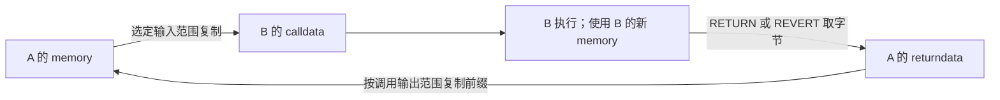

# 14：EVM 内存与抽象字节数组

学习入口：[模块：Memory & Storage](modules/memory-storage.md) · [理论：内存与别名](routes/theory.md#memory-storage) · [实现：ByteArray 与读写](routes/implementation.md#memory-storage) · [选择路线](learning-routes.md)。

`MSTORE` 把栈上的数写进 memory，`MLOAD` 再读出来。写入的是确定的数时，这很直观；如果数或地址都有多种可能，分析器应该保存什么？这就是本课要解释的内存模型。

本课按三步展开：先画出一次真实执行中的字节；再把多次执行投影成逐字节的数值表；最后检查完整状态根怎样保留表中看不到的地址、写序与条件。数值表方便观察，但它不是完整内存模型。每个实验都先限定输入，再读抽象结果；一个 `⊤` 或 `Converged` 标签不能单独回答内容是否精确、执行是否完整。

读过[第 00 课](00-start.md)的栈表即可开始。所有命令在仓库根目录执行，都是离线例子，不需要 RPC、钱包或资金。`nix run . --` 后面是本项目的参数；首次构建可能需要下载依赖。本课使用默认 Osaka。不了解集合或 `⊤` 时，遇到它们再回看[第 02 课](02-domain.md)。

## 1. 先把字节、word 和偏移分开

一个 **bit** 是一位，只能是 0 或 1。一个**字节**（byte）有 8 位，数值范围为 0～255，写成十六进制就是 `00`～`ff`。两个十六进制数字表示一个字节；`0x` 是进制前缀，不占字节。

EVM 栈上的一个 **word** 有 256 位，也就是 **32 字节**。memory 按字节寻址：偏移 0、1、2 是三个相邻字节的位置，偏移不是 word 的编号。

| 写法 | 含义 |
| --- | --- |
| `MLOAD(1)` | 从字节偏移 1 开始读取 32 字节，即偏移 1～32 |
| `MSTORE(1, x)` | 从字节偏移 1 开始写入 x 的 32 字节编码 |
| `MSTORE8(1, x)` | 只向偏移 1 写入 x 的最低 8 位 |
| `[1,33)` | 包含偏移 1，不包含偏移 33，共 32 字节 |

上面的函数形式是为了讲解指令参数，不是 EVM 源码语法。实际指令从栈取参数。本文的栈按**栈底 → 栈顶**排列，最右边是栈顶；例如执行 MSTORE 前的 `[x, 1]`，先弹出偏移 1，再弹出要写的 x。`MLOAD(1)` 不要求地址按 32 字节对齐。

把 memory 看成一排带编号的格子，每个格子只放一个字节：

```text
字节偏移：  0   1   2   3  ……  30  31  32  ……
字节内容： 00  00  00  00  ……  00  00  00  ……
```

一次真实执行中，每个已访问位置都有一个确定字节。分析器遇到未知输入时，需要用一份状态表示多次可能执行，因此一个格子才可能显示 `{0x0,0xaa}`。集合属于分析器的知识；EVM 并不会在一个格子里同时放两个字节。

## 2. 第一个实验：写入 42，再读出来

运行：

```bash
nix run . -- explain --file examples/memory-word.hex
```

它的字节码是 `60 2a 5f 52 5f 51 59 00`，先手算：

| pc（十六进制） | 指令 | 执行后的栈（底 → 顶） | memory 的变化 |
| --- | --- | --- | --- |
| `0x00` | `PUSH1 0x2a` | `[42]` | 无变化；`0x2a` 就是十进制 42 |
| `0x02` | `PUSH0` | `[42,0]` | 准备写入偏移 0 |
| `0x03` | `MSTORE` | `[]` | 写入 `[0,32)`，当前长度变为 32 |
| `0x04` | `PUSH0` | `[0]` | 准备读取偏移 0 |
| `0x05` | `MLOAD` | `[42]` | 读取 `[0,32)`；长度仍为 32 |
| `0x06` | `MSIZE` | `[42,32]` | 把当前内存长度压栈 |
| `0x07` | `STOP` | `[42,32]` | 结束 |

在 CFG 部分找到：

```text
  stack in  []
  stack out [{0x2a}, {0x20}]
```

外层方括号表示栈的两个槽位。`{0x2a}` 是第一个槽唯一可能的值 42；`{0x20}` 是第二个槽唯一可能的值 32。它们分别来自 MLOAD 和 MSIZE，不能把 `0x20` 读成十进制 20。

这里观察的是块入口和出口的摘要。中间每一步发生什么，由上面的指令表解释；`explain` 的短输出没有直接列出整份 memory。

### 42 在 memory 里长什么样

MSTORE 使用**大端**编码：高位字节放在较小的地址，低位字节放在较大的地址。42 的 32 字节编码如下：

| 字节偏移 | `0`～`30`，共 31 字节 | `31` |
| --- | --- | --- |
| 内容 | 每个字节都是 `00` | `2a` |

读这 32 字节时，MLOAD 按同一顺序拼回数值 42。下面的图描述 word 的字节语义；实现同时保留不可变状态根：


### 为什么小数会写成 32 字节

MSTORE 的写入宽度由指令决定，不由数值有几个非零字节决定。42 可以用一个字节表示，但 MSTORE 仍然写满 32 字节。可以把它看作在左边补 31 个零：

```text
word 42 的编码：00 … 00 2a      共 32 字节
MSTORE(0,42)：  写到偏移 0 … 31
MSTORE(1,42)：  写到偏移 1 … 32
```

大端决定的是**这 32 字节内部的顺序**；偏移决定的是**整段编码从哪儿开始**。例如 MSTORE(1,0x1234)：

| 编码中的字节编号 | memory 偏移 | 内容 |
| --- | --- | --- |
| 0～29 | 1～30 | `00` |
| 30 | 31 | `12` |
| 31 | 32 | `34` |

MLOAD(1) 读取 1～32，因此得到 `0x1234`。MLOAD(0) 读取的窗口是 0～31，包含 `12`、不包含 `34`，因而得到 `0x12`。同一排字节，用不同读取窗口可以得到不同 word；memory 里没有额外保存一个名叫“0x1234”的整数对象。

## 3. Rust 里怎样保存这份 memory

[`ByteArray`](../crates/evm-abstract/src/world/bytes.rs) 保存内容根 `ByteStateId`、抽象 length、已具体展开的数值 bytes/default，以及 memory 标志。内容根通过 Zero、Input、Exact、WriteByte、WriteWord、Copy、Slice、Ite 表达来源、地址和更新顺序。`view()` 捕获 root、offset、length；后续写入产生新根，不修改历史 view。

| 观察 | 含义 |
| --- | --- |
| `length` | 逻辑字节长度；memory 中按 32 字节扩容 |
| `root` | 完整来源、写序、复制范围与条件 |
| `bytes` / `default` | 显式数值观察与保守回退；需结合 root 解释，不能独立重建 lazy 内容 |
| `memory` | 是否启用内存扩容语义 |

### 没有表项，不等于字节未知

新 memory 的 Zero 根保证初始内容全零。Input 有独立来源和有限长度；Exact 保存精确 source。Copy 可以改变大片内容而没有逐字节生成表项，所以不能只靠 `bytes.len()` 或 default 重建 lazy array。读取同时解释根与 view 边界，普通源在边界之外补零。

### 每个字节为什么也用 AbstractValue

数值事实仍包含有限候选、位、signed/unsigned interval、congruence、nonzero 与 provenance；表达式另保存读自哪个历史状态。数值摘要 Top 不必意味着来源或读写关系丢失。完整跨值条件属于整机 RelationState，不能仅凭来源标签证明别名。详细节点与格式见[第 17 课](17-symbolic-state.md)。

## 4. 初始零、扩容和 MSIZE

每个新帧的 memory 初始状态是：

```text
length  = {0x0}
bytes   = 空表
default = {0x0}
memory  = true
```

访问结束位置是 `offset + size`，memory 长度按 32 字节向上取整，并与已有长度取较大值：

```text
访问后的长度 = max(原长度, ceil((offset + size) / 32) × 32)
```

上式描述确定地址和非零长度的成功访问；大小为零的访问不扩容，也不因为偏移很大而分配空间。

| 原长度 | 访问 | 覆盖的字节 | 新长度 |
| --- | --- | --- | --- |
| 0 | `MLOAD(0)` | 0～31 | 32 |
| 0 | `MSTORE(1, x)` | 1～32 | 64 |
| 0 | `MSTORE8(31, x)` | 31 | 32 |
| 0 | `MSTORE8(32, x)` | 32 | 64 |
| 64 | `MLOAD(0)` | 0～31 | 64 |

**读取也会扩容。** 验证这个容易混淆的地方：

```bash
nix run . -- explain --hex 595f515900
```

指令是 `MSIZE; PUSH0; MLOAD; MSIZE; STOP`。出口应为：

```text
  stack out [{0x0}, {0x0}, {0x20}]
```

三个槽依次是：访问前的长度 0、从新 memory 读出的数值 0、访问后的长度 32。内存的当前长度与读取到的内容分别变化。

源码分成两层：`ByteArray::read_word` 只读取已有摘要，本身不扩容；执行 EVM 的 MLOAD 时，[指令转换](../crates/evm-abstract/src/analysis/transfer.rs)先调用 `touch_memory` / `expand`，再调用 `read_word`。直接阅读这些 Rust 辅助函数时要保留这个顺序。

## 5. MSTORE8：只取最低一个字节

```bash
nix run . -- explain --hex 6112ff5f535f515900
```

它把 `0x12ff` 压栈，向偏移 0 执行 MSTORE8，再从偏移 0 MLOAD，最后读 MSIZE。

MSTORE8 只写入 `ff`，丢弃更高的 `12`。因此第一个 byte 是 `ff`，后面 31 个 byte 仍为零。MLOAD 使用大端拼接，得到完整 word：

```text
0xff00000000000000000000000000000000000000000000000000000000000000
```

MSIZE 是 `0x20`。MSTORE8 写出的一个字节放在 word 的哪个位置，取决于它的地址；在偏移 0 写 `ff` 后从偏移 0 读 word，`ff` 位于最高字节，而不是最低字节。

把命令里的第一个 `5f` 改成 `601f`，就改为在偏移 31 写 `ff`；后面的 `5f51` 仍从偏移 0 读取。此时 MLOAD 的结果应为 `0xff`，长度仍为 32。尝试在运行前手算这个变化。

### 在一个已写入的 word 中覆盖一个字节

前面都从全零 memory 开始。现在先写入 `0x1234`，再修改它的两个低位字节：

```bash
nix run . -- explain --file examples/memory-word-overwrite.hex
```

所有偏移和写入值都确定，没有未知输入参与这些操作。先只画偏移 30、31，前面 30 个字节始终为零：

| 步骤 | 伪语法 | 偏移 30 | 偏移 31 | 此时 MLOAD(0) 的值 |
| --- | --- | --- | --- | --- |
| 1 | `MSTORE(0,0x1234)` | `12` | `34` | `0x1234` |
| 2 | `MSTORE8(30,0xaa)` | `aa` | `34` | `0xaa34` |
| 3 | `MSTORE8(31,0xbb)` | `aa` | `bb` | `0xaabb` |

步骤 2 只替换 `12`，不会重新把整个 word 写成 `0xaa`；步骤 3 不会追溯修改步骤 2 已经读出的值。程序分别保留两次 MLOAD 的结果，再压入 MSIZE，因此应看到：

```text
  stack out [{0xaa34}, {0xaabb}, {0x20}]
```

第一槽是较早读到的 `0xaa34`，第二槽是较晚读到的 `0xaabb`。栈中已有的 word 是当时的读取结果，不是持续指向 memory 的引用。这个时间差别同样适用于 storage 的读取。

## 6. 地址确定时覆盖，地址有几个候选时合并

具体偏移保留原有数值快路径；符号偏移写入也保存有序状态节点。对 p∈{0,1} 的 `MSTORE8(p,0xaa)`，逐位置数值摘要仍可能把偏移 0 和 1 都表示为 `{0,0xaa}`。这两组候选只是投影，不能据此断言同一具体执行同时选择两个 `0xaa`。

### 数值表与完整读取怎样对照

[`memory-write-alias.hex`](../examples/memory-write-alias.hex) 根据未知 calldata 选择 p=0 或 p=1，向 p 写一个 `aa`，再 MLOAD(0)。先列两次具体执行：

| 选择 | memory 的前两字节 | MLOAD(0) |
| --- | --- | --- |
| p=0 | `aa 00` | `0xaa × 2^248` |
| p=1 | `00 aa` | `0xaa × 2^240` |

```bash
nix run . -- cfg --file examples/memory-write-alias.hex \
  --context-depth 0 --format json > /tmp/memory-alias.json
jq '.states[] | select(.key.basic_block_index == 3)
    | .exit_stack[0].Constants' /tmp/memory-alias.json
```

默认关系模式下，这个例子的 MLOAD 只保留表中的两个 word。若把两个 byte 的 `{0,0xaa}` 独立组合，还会得到全零或同时两个 `aa`；这些额外组合属于逐字节投影，不是本例完整读取的结果。WriteByte 保存同一个 p，整机 guarded join 为地址、值、memory/store 根和路径公式使用同一个 selector，保留两侧配对。

这个例子展示已保留关系能改善读取，不保证任意读取都能得到精确候选。value 查询无法完成时仍保守保留数值与精度诊断；effect 编号或显示相同的 Top 不能证明别名。

## 7. 无法列出地址，与无法列出长度，是两个问题

### 7.1 不知道读哪儿

WordRead 捕获有限 view 和符号地址，保留 32 字节大端读取及零补语义。来源与路径事实可能证明结果；无法完成 value 查询时保留宽数值和 typed precision diagnostic。地址未知本身不要求清空内容关系。

### 7.2 不知道写哪儿

WriteByte/WriteWord 保存符号偏移、值和旧根。后续同址或别名读取可以由规范化与 SMT 得到结论；已存的历史读取不会随新写入改变。

<a id="同一个未知偏移写后再读也未必恢复原值"></a>

### 同一个符号偏移，写后再读

先让未知输入 x 产生 p=`x AND 63`。p 仍有 64 种可能，地址没有具体化；但 32 字节访问所需的内存范围有界。程序保留 p，在同一位置写 7 再读：

```bash
nix run . -- cfg --hex 5f35603f16600781525100 \
  --format json > /tmp/memory-same-address.json
jq '.states[0].exit_stack[0].Constants' /tmp/memory-same-address.json
```

结果为 `["0x7"]`。WriteWord 保存符号地址 p，WordRead 捕获写后的根与同一个 p，所以无需先枚举 p 的全部候选来恢复 7。原来已读出的 word 仍绑定旧根。

再保留完全无约束的 p，运行原始 [`memory-symbolic-offset.hex`](../examples/memory-symbolic-offset.hex)：

```bash
nix run . -- cfg --file examples/memory-symbolic-offset.hex --format json
```

策略内执行的出口也读出 7，同时报告 `Incomplete`、退出码 2，并保留超内存策略的 frontier。问题是还有访问范围未覆盖，不能据此说符号写后读退化成 Top。关闭关系查询、表达式构造超限或 solver 未完成也各有自己的精度与覆盖边界；本例不证明所有地址公式都能被精确求解。

### 7.3 不知道复制多少字节

`366000803700` 将未知 calldata 完整复制到 memory。输入长度有一个可信表达式，Copy 保存 source view 与同一长度，不要求枚举所有大小，也不展开整个范围。超过配置 logical footprint 的输入保留 MemoryPolicy witness，包括原 offset/size/limit、condition、选中 side 和 pre-effect payload。

普通库调用若只提供没有表达式的 Top size，仍会报告 ByteRange::UnknownSize。这不能与带来源和长度表达式的 EVM COPY 混淆。RETURNDATACOPY 的源边界、MCOPY 的重叠和双向内存扩容另外遵守各自指令规则。

<a id="8-为什么刚存进去再读出来会多出候选"></a>

## 8. 逐字节候选与完整 word 的关联

设一个 word 只能是 `0x0101` 或 `0x0202`，前 30 字节全零。分别观察最后两个 byte，它们各自都允许 `{01,02}`。独立拼接得到 `0101`、`0102`、`0201`、`0202` 四个组合，其中两个从未出现在原来的 word 中。这个推导说明逐字节表的信息不足，不说明当前 WordRead 必然读出四个值。

[`memory-byte-correlation.hex`](../examples/memory-byte-correlation.hex) 根据未知输入选择上述两个 word，在控制流汇合后 MSTORE(0)，再 MLOAD(0)：

```bash
nix run . -- cfg --file examples/memory-byte-correlation.hex \
  --context-depth 0 --format json > /tmp/memory-correlation.json
jq '.states[] | select(.key.basic_block_index == 3)
    | .exit_stack[0].Constants' /tmp/memory-correlation.json
```

默认模式输出 `["0x101","0x202"]`。完整 WordWrite/WordRead 保存同一个输入 word 和写序，恢复的是两种完整选择。partial overwrite 则需要逐一解释覆盖范围：`MSTORE(p,x); MSTORE8(p+31,0xaa)` 改变最后一个 byte，不能继续宣称整个 word 等于 x。

上下文分区可以让两条路暂时保持为不同状态；发生整机 join 时，共享 selector 继续保留字段配对。数值投影仍可能宽于关系结果，且更复杂的表达式可能遇到查询或构造边界。阅读时应同时检查 WordRead、历史根、路径条件、诊断与 frontiers，不能把独立 byte 的交叉组合当作已经证明可行。

## 9. 组合域能保留字节性质，但寻址与关联仍是另一层

本节用 `--no-relations` 比较数值组件。下面只保留输入的最低字节，再把最低位设为 1，将结果写入偏移 31，随后从偏移 0 读取整个 word：

```bash
nix run . -- explain --hex 5f3560ff16600117601f535f515900 \
  --max-constants 1 --domain product --no-relations
```

表达式是 `(x AND 255) OR 1`，结果为 1～255 中的奇数。偏移 0～30 仍为零，所以 MLOAD 的结果也是这些奇数。`--max-constants 1` 只能保存一个常量，装不下全部 128 个候选；product 的其他组件应继续保留：

- 无符号范围 `u[0x1,0xff]`。
- 高 248 位为零，最低位为一：`bits=0x` 后是 62 个 `0`、一个 `*`、一个 `[***1]`，共 64 个十六进制位置。
- `mod(0x2)=0x1` 和非零保证 `≠0`。
- MSIZE 为 `{0x20}`。

完整出口模式如下；`*` 和方括号中的每一位都保留，可以逐项对照：

```text
  stack out [u[0x1,0xff] bits=0x00000000000000000000000000000000000000000000000000000000000000*[***1] mod(0x2)=0x1 ≠0, {0x20}]
```

换成只保存有限常量集合的模式比较：

```bash
nix run . -- explain --hex 5f3560ff16600117601f535f515900 \
  --max-constants 1 --domain constants-only --no-relations
```

本例出口为 `[⊤, {0x20}]`。这里损失的是字节内容的数值性质，地址 31 仍确定，所以内存长度仍能保留。

这解释了三个不同问题：NumericValue 决定一个位置上的数值精度；寻址规则决定可能读写哪些位置；字节之间的关联决定哪些组合可同时发生。改善其中一层，不会自动解决另外两层。

## 10. COPY：复制字节与读取 word 有什么区别

| 指令 | 从哪里取字节 | 写到哪里 |
| --- | --- | --- |
| `CALLDATACOPY` | 当前帧 calldata | 当前帧 memory |
| `CODECOPY` | 当前执行的代码字节 | 当前帧 memory |
| `RETURNDATACOPY` | 最近一次子调用的返回数据 | 当前帧 memory |
| `MCOPY` | 当前帧 memory | 同一帧 memory |

copy 的栈在取参数前按 `[size, source_offset, target_offset]` 排列，右边的目标偏移先弹出。它复制任意长度的字节序列，不需要把序列解释成整数。

MLOAD、CALLDATALOAD、CALLDATACOPY、CODECOPY 的读取按相应规则补零；RETURNDATACOPY 另有返回数据范围检查，超出返回数据会失败，不能笼统把所有越界复制都当作补零。即使 size=0，也仍须检查 RETURNDATACOPY 的源偏移规则；零大小不扩张 memory，不代表整条指令总是合法。

### MCOPY 的重叠区域

如果源和目标重叠，必须按复制前的源内容取值。运行：

```bash
nix run . -- explain --file examples/memory-overlap-copy.hex
```

程序先把 `0x01020304` 用 MSTORE 写入偏移 0，所以偏移 28～31 是 `01 02 03 04`。随后执行：

```text
MCOPY(target=29, source=28, size=3)
```

| 位置 | 28 | 29 | 30 | 31 |
| --- | --- | --- | --- | --- |
| 复制前 | `01` | `02` | `03` | `04` |
| 复制后 | `01` | `01` | `02` | `03` |

MLOAD(0) 得到 `0x01010203`，MSIZE 仍为 32，出口显示 `[{0x1010203}, {0x20}]`。如果错误地边写边读已经被覆盖的源字节，就会得到连续多个 `01`；本实现先保存源 memory 的快照，再执行复制。这是 **memmove** 式的重叠复制语义。[指令取快照与复制](../crates/evm-abstract/src/analysis/transfer.rs)和 [`copy_from`](../crates/evm-abstract/src/world/bytes.rs)分别承担这两步。

## 11. 每个帧的 memory 独立，调用通过字节传递数据

**帧**（frame）是一次合约执行所用的栈、memory、calldata 等上下文。A 调用 B 时，A 暂停，B 使用自己的新栈和新 memory；B 返回后，A 继续使用原来的 memory。[FrameState](../crates/evm-abstract/src/analysis/machine/frame.rs) 中的 `memory` 属于该帧。



DELEGATECALL 也创建独立的 memory。它复用调用方的 storage 状态账户，并不因此共用 memory；重入后的另一份 A 帧也有新 memory。帧间共享的账户状态与帧内临时字节区分别处理，详见[第 09 课](09-cross-contract.md)。

### 顺着一次成功调用观察三份字节区

先限定一个用于手算的调用：A 的 memory 偏移 0～3 已经是 `11 22 33 44`；A 选择输入 `[0,2)`，请求把输出写回 `[0,4)`。B 能成功执行，并最终返回 `bb cc` 两字节。这里先不合并 gas 失败等其他路径。

| 时刻 | A 的 memory：偏移 0～3 | B 的 calldata | B 的 memory |
| --- | --- | --- | --- |
| CALL 前 | `11 22 33 44` | B 帧尚未创建 | B 帧尚未创建 |
| B 刚进入 | `11 22 33 44`，A 暂停 | `11 22`，长度 2 | 全零，长度 0 |
| B 在自己的 memory 写入返回内容 | 仍是 `11 22 33 44` | 仍是 `11 22` | 偏移 0、1 为 `bb cc`，长度扩到 32 |
| B 执行 RETURN(0,2) 后 | `bb cc 33 44` | B 已返回 | B 帧已结束 |

这里每一步有不同的复制关系：

1. 创建 B 时，从 A memory 取输入切片，形成 B calldata。不是把 A memory 整体交给 B，也不是把输入自动写进 B memory。
2. B 写自己的 memory，不会改变已经复制的 calldata，也不会直接覆盖 A memory。
3. B 的 RETURN 从 B memory 取切片 `bb cc`，形成返回数据。父帧保存完整 returndata，再按 CALL 的输出参数复制回 A memory。

B 用 CALLDATALOAD 把一个输入 word 读到自己的栈上；需要可修改的 memory 工作区时，则用 CALLDATACOPY 把输入字节复制进去。只因 calldata 与 memory 底层都用 ByteArray，不意味着它们是同一份可修改数组。

这里有两组长度：B 实际返回的数据长度，以及 A 在 CALL 中请求的输出区长度。返回数据完整保存为 A 的 `returndata`；向 A memory 复制的只是 `min(请求长度, 实际返回长度)` 个字节。输出区按整个请求范围扩张，未被返回字节覆盖的后缀保留原内容。

例如 A 请求复制 4 字节，B 实际只返回 2 字节，那么前两字节被替换，后两字节保留。返回长度为符号值 L 时，[`copy_return_data`](../crates/evm-abstract/src/world/bytes.rs) 先按完整请求范围扩容，再保存一次长度为 `min(4,L)` 的 Copy；[`minimum`](../crates/evm-abstract/src/world/bytes/ranges.rs) 用比较和 ITE 保留这个长度关系。Copy 捕获完整 returndata 的 source view，未覆盖后缀仍来自旧 memory。

所有位置共用同一个复制长度。例如 L=0 时一个 byte 都不覆盖；L=1 时只覆盖首 byte；L=2 时才覆盖前两个。独立观察每个 byte 可能同时列出旧值与返回值，但完整根没有将每个位置变成彼此无关的开关。具体前缀保留与符号最小长度由[字节状态回归](../crates/evm-abstract/src/world/bytes/tests/state.rs)检查；这项模型关系也不保证所有复杂返回长度的 solver 查询都能完成。

改变刚才例子的输出大小，其他前提保持不变：

| A 在 CALL 中请求的输出大小 | 返回后的 A memory：偏移 0～3 | A 的完整 returndata |
| --- | --- | --- |
| 0 | `11 22 33 44`，没有自动复制 | `bb cc`，长度仍为 2 |
| 1 | `bb 22 33 44` | `bb cc`，长度仍为 2 |
| 4 | `bb cc 33 44` | `bb cc`，长度仍为 2 |

输出大小限制的是这一次自动复制，不会截断 returndata 的保存。第一行中，A 仍可稍后用 RETURNDATACOPY 取回 `bb cc`。下一次 CALL 完成后，“最近一次调用”的 returndata 会被新结果替换；它不是所有历史返回数据的追加日志。

CALL 的成功位是另一个压栈结果。成功位、完整 returndata、已复制到 memory 的前缀是三件事。子帧 REVERT 会回滚账户状态，但可以带回 revert data；具体哪些字节会复制要按调用结果和输出范围阅读，不能仅凭成功位为零断定所有 returndata 都为空。

现成实验可观察 CALL 没有自动复制输出时，A 如何稍后取回 returndata：

```bash
nix run . -- explain --world examples/worlds/returndata-copy.json \
  --evm.to 0x0000000000000000000000000000000000000101 \
  --evm.caller 0x0000000000000000000000000000000000001000 \
  --evm.value 0 --evm.calldata 0x
```

在具体成功路径上，A 的 CALL 请求输出大小为 0，B 返回 32 字节数值 1；A 随后通过 RETURNDATACOPY 复制并返回它们。模型还保留 gas 等失败可能，阅读各个 outcome，不要把成功路径说明当作唯一结果。

可以在这个实际例子中逐项对照上面的三份字节区：

| 步骤 | 谁执行 | 发生什么 |
| --- | --- | --- |
| 1 | A | CALL 的输入和输出大小都为 0，调用 B |
| 2 | B | 在自己的新 memory 中执行 MSTORE(0,1) |
| 3 | B | RETURN(0,32)，返回 31 个零和最后一个 `01` |
| 4 | A | 恢复执行；memory 尚未自动复制返回字节，但 RETURNDATASIZE 为 32 |
| 5 | A | 将返回长度写入 storage slot 0，再 RETURNDATACOPY(0,0,32) |
| 6 | A | RETURN(0,32)，从 A 的 memory 返回同一字节序列 |

这不是 A 直接读到了 B 的 memory。数据经过了 B memory → returndata → A memory 两次取片或复制。失败路径的返回长度和结果不同，应单独查看。

## 12. 怎样看完整 memory，而不只看 stack out

`stack out` 是栈投影。完整世界 JSON 同时保存 entry、exit、root/child frames；原生 memory 的 `.root` 是有界 flat graph。先保存具体例子：

```bash
nix run . -- analyze --world examples/memory-word-bound.json \
  --evm.to 0x0000000000000000000000000000000000000101 \
  --evm.value 0 --evm.calldata 0x --format json > /tmp/evm-memory.json
nix develop -c jq '.states[0].exit.call_stack.root.state.memory | {length, root, memory}' /tmp/evm-memory.json
```

本例从偏移 1 写 32 字节，再读取同一窗口；逻辑长度为 64，读取结果为 0x1234。其他程序的 root 可能只有一条大范围 Copy 而没有逐字节表项。Web 协议通过 `byte_arrays[].symbolic` 引用共享 `symbolic.nodes`；scalar refs、来源、范围和数值事实均可观察。

### 返回数据的文本字节表

完整文本中的 stored byte facts 是数值观察，`exact hex` 仅在有界提取成功时显示。没有 exact payload 不能推出空数据；lazy source、长度和 range 根仍需保留。工作台 virtualized DAG 行显示 Copy/View/Write/guard，精确源只预览有限前缀；不渲染整个大 range。

## 13. 范围上限、错误与分析完成状态

CLI/Web 的 `max_memory_bytes` 默认 64 MiB，库 ExecutionConfig 默认 64 KiB。该策略约束 word-rounded **logical footprint**，不要求逐字节复制或巨量分配；也不是主机峰值 RAM。用 `--max-memory-bytes` 调整输入覆盖范围，不提供未知长度的实际值。

范围先保留 size=0 分支，再以非回绕算术检查访问及 MSIZE。策略内继续执行；超策略输入保存 MemoryPolicy condition 和 pre-effect 状态，标记 Incomplete，不能显示成真实 EVM out-of-gas。单字节码 `cfg` 的教学投影将这类原因简写为 `Memory`；完整 `analyze --world` 的 `.frontiers[].range` 与 Web 报告另保留范围条件和待处理载荷。RETURNDATACOPY 的源越界属于指令异常语义，另与表示失败 ByteRange 区分。

`OperandsConsumed` 表示参数已弹出，但效果尚未完成；报告与部分 SSA 不伪造结果。Work、Relations、StateJoin、ByteRange 与 Memory 的 typed 原因分别保留。可选 value 查询的 UNKNOWN 是精度损失；条件未保留或覆盖未完成才是 frontier。

构造、求解和导出各有节点、深度、work、exact payload 预算与取消点。原生 graph 默认 exact payload 为 16 MiB；Web metadata 明示实际 projection work。限制和错误详见[第 17 课](17-symbolic-state.md)，完整本地测试证据由集成验收记录。

## 14. 从源码找到每条规则

先读本文例子，再按下表找实现。无需一次读完整分析器。

| 想核对的规则 | 源码入口 |
| --- | --- |
| 内容根、数值事实、初始零与长度补零 | [`world/bytes.rs`](../crates/evm-abstract/src/world/bytes.rs)：`ByteArray`、`memory`、`byte_at` |
| MSTORE/MSTORE8 有序 byte/word 更新 | 同文件的 `write_word`、`write_byte`、`write_values` |
| 32 字节取整、范围上限 | `world/bytes/ranges.rs` 和 `analysis/transfer/ranges.rs` |
| WordRead、guarded join 与 captured-source 重叠复制 | 同文件的 `read_word`、`join`、`copy_from` |
| EVM 指令何时触碰 memory、错误怎样成为前沿 | [`analysis/transfer.rs`](../crates/evm-abstract/src/analysis/transfer.rs)：`touch_memory`、MLOAD、MSTORE、COPY 分支 |
| 帧的 memory 与子调用输入/输出 | [`machine/frame.rs`](../crates/evm-abstract/src/analysis/machine/frame.rs)、[`transfer/calls.rs`](../crates/evm-abstract/src/analysis/transfer/calls.rs) |
| 零填充、有限地址写入、范围、复制的现有回归 | [`tests/world.rs`](../crates/evm-abstract/tests/world.rs) |
| 非有限字节值仍保留范围与奇偶性质 | [`tests/product_domains.rs`](../crates/evm-abstract/tests/product_domains.rs) |

普通单程序 SSA 主要给栈值起名字；跨合约 SSA 还通过效果链记录包括 memory、账户状态和回滚点的整机变化。当前效果没有按具体内存地址分区，结构验证也不会补回已经丢失的字节关联；详见[第 09 课的完整 SSA](09-cross-contract.md#默认文本怎样读)。

## 15. 六个自检问题

先回答，再看提示；这些问题分别检查字节顺序、地址、关联和完成状态。

1. 在新 memory 中执行 MSTORE(1, 0x1234)，MSIZE 是 32 还是 64？`12`、`34` 分别在什么偏移？
2. 对新 memory 执行一次 MSTORE8(p, 0xaa)，其中 p∈{0,1}。合并后两个字节各自有 `{0,0xaa}`，是否证明一次真实执行能同时把两个位置写成 `aa`？
3. word 只允许 `{0x0101,0x0202}`，为什么独立 byte 候选可拼出四个组合，而第 8 节的完整 MLOAD 只输出两个？Converged 是否要求所有数值都精确？
4. 有来源与长度表达式的未知 COPY、只有 Top 而没有表达式的 size、超过内存策略的范围，分别应怎样解释？
5. 同一个符号 p 被保留，MSTORE(p,7) 后 MLOAD(p) 为什么无需枚举地址也能得到 7？完全无约束 p 的例子为什么仍为 Incomplete？
6. A 的 CALL 请求输出大小为 0，B 成功返回 32 字节，A 的 returndata 是否也为空？A 能直接读取 B 的 memory 吗？

<details>
<summary>提示与答案</summary>

1. 访问 `[1,33)`，向上取整到 64；高 30 个字节为零，`12` 在偏移 31，`34` 在偏移 32。地址无需按 word 对齐。
2. 不能。一次真实执行只写一个位置；独立候选看不到两者的配对，完整 WriteByte 与共同 guard 另保留这项关系。
3. 独立 byte 候选允许交叉选择；本例完整 WordWrite/WordRead 保留原 word 的关系，所以得到两个候选。Converged 表示在声明模型与策略下完成传播，允许保守的多余候选，不要求每个查询都精确。
4. 第一种保存 source view、符号长度与一次 Copy，合法策略内无需逐字节展开。第二种无法建立可信范围，表示层可返回 ByteRange::UnknownSize。第三种保留 MemoryPolicy 条件和效果执行前的状态，表示策略下尚未覆盖的输入；不是已证明的 EVM 失败。
5. WriteWord 与 WordRead 引用同一地址和写后根，保存了符号索引更新关系。无约束 p 还包含超出 logical footprint 策略的访问，必须保留 frontier；策略内读出 7 不能覆盖那些输入。
6. returndata 仍有完整 32 字节。大小为 0 只关闭这次自动输出复制；A 可以随后 RETURNDATACOPY 到自己的 memory。A 不能直接读取 B 的私有 memory。

</details>

接着读[第 16 课](16-storage-model.md)，用同样的前后状态表比较 storage 的默认值、读写与回滚；[第 15 课](15-symbolic-relations.md)进一步解释表达式和路径条件怎样保留关系。也可以回到[第 09 课](09-cross-contract.md)观察实际调用图，或读[第 12 课](12-product-domains-facts.md)研究单个 AbstractValue 的数值性质。[例子索引](../examples/README.md)列出本课的可运行输入。
