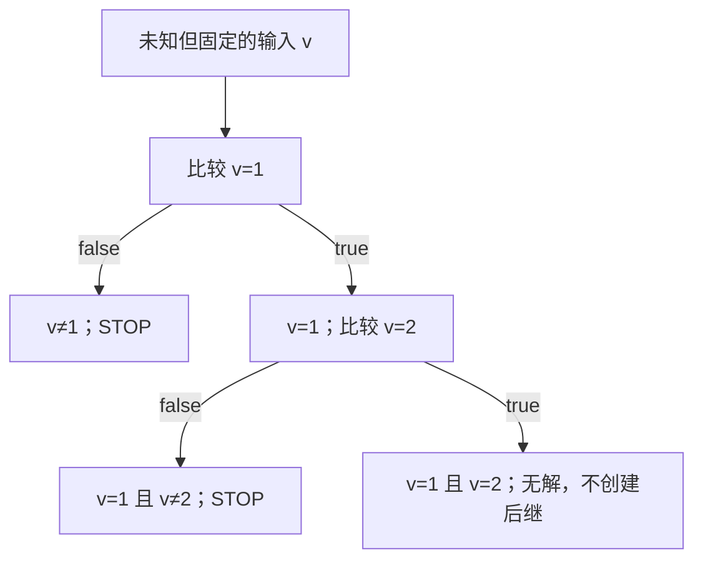

# 15：用表达式与关系约束筛掉矛盾分支

学习入口：[模块：符号关系与局部推理](modules/relations.md) · [理论：身份、路径与关系](routes/theory.md#relations) · [实现：表达式与局部推理接口](routes/implementation.md#relations) · [选择路线](learning-routes.md)。

[第 12 课](12-product-domains-facts.md)解释一个值保存哪些数值性质，[第 13 课](13-evm-environment.md)说明这些值对应哪些固定输入。本课再看多个值之间的关系，以及分支条件怎样限制后续执行。先只追踪一个输入和两个比较，再把这些信息放回 memory、storage 和调用中。具体字节位置与 slot 还不熟时，可以先读[第 14 课](14-memory-model.md)和[第 16 课](16-storage-model.md)的单单元实验。

## 1. 先看同一个输入不能同时等于 1 和 2

下面的程序保留同一次调用的 CALLVALUE，先判断它是否等于 1；进入 true 分支后，再判断它是否等于 2：

```bash
nix run . -- cfg --hex 3480600114600957005b80600214601257005b00 \
  --context-depth 0 --format json > /tmp/relations.json
```

### 先把这段程序读成三个小步骤

CALLVALUE 是本次调用附带的 wei 数量。省略 `--evm.value` 时，它没有被设置为零；我们用 v 表示同一帧中固定但未知的输入。先用伪语法理解控制流：

```text
v = CALLVALUE
if v == 1:
    if v == 2:
        到达末尾的块
```

函数形式和 if 只是教学记号。实际程序用 DUP 保留 v，再用 EQ 产生 0/1，最后让 JUMPI 弹出条件。关键片段如下；栈的最右边是栈顶。

| pc | 指令 | 执行后保留下来的栈 | 新发生的事 |
| --- | --- | --- | --- |
| `0x00` | CALLVALUE | `[v]` | 读入一个未知输入 |
| `0x01` | DUP1 | `[v,v]` | 两份位置保存同一个值 |
| `0x02` | PUSH1 1 | `[v,v,1]` | 准备第一次比较 |
| `0x04` | EQ | `[v,c1]` | c1 是 v 与 1 是否相等的 0/1 结果 |
| `0x05` | PUSH1 9 | `[v,c1,9]` | 9 是跳转目标的字节 pc |
| `0x07` | JUMPI | `[v]` | 弹出目标与 c1；为两个后继分别增加条件 |
| `0x09` | JUMPDEST | `[v]` | 只有第一次比较成立才进入这里 |
| `0x0a` | DUP1 | `[v,v]` | 保留 v，再比较一次 |
| `0x0b` | PUSH1 2 | `[v,v,2]` | 准备第二次比较 |
| `0x0d` | EQ | `[v,c2]` | c2 是 v 与 2 是否相等的结果 |
| `0x0e` | PUSH1 18 | `[v,c2,18]` | 18 即 `0x12`，不是状态编号 |
| `0x10` | JUMPI | `[v]` | 第二条 true 边还要求 v=2 |

第一次 JUMPI 的 false 后继在 `0x08` STOP；第二次的 false 后继在 `0x11` STOP。末尾 `0x12` 的 JUMPDEST 不是因为字节码无效而消失，而是没有输入能满足到达它的两项条件。

### 符号身份与路径条件各提供一半知识

“这是同一个 v”只说明两次使用有关联，没有说明 v 等于几。进入第一次 true 分支，才增加“当前路径上 v=1”。用 Φ 表示到达当前位置必须满足的条件，避免与字节码程序计数器 pc 混淆：

| 位置 | 当前路径条件 Φ | 能得到的知识 |
| --- | --- | --- |
| 第一次比较前 | true | v 可以是任意 U256 |
| 第一次 true 后继 | v=1 | 这里的输入只能取 1 |
| 第一次 false 后继 | v≠1 | 仍可取很多值，不能擅自选一个 |
| 第一次 true，再第二次 false | v=1 AND v≠2 | 可以发生；v=1 |
| 连续两次 true | v=1 AND v=2 | 矛盾；没有具体执行 |



关系层首先知道 EQ 的操作数和运算含义，才能把“c1 非零”解释成“v=1”。如果只保留 c1 的数值 `{0,1}`、丢掉它来自 `EQ(v,1)` 的关系，走过 true 边也不能自动收窄 v。

### 从 JSON 中确认边确实被排除了

状态 σᵖᵢ 与原始块 Bᵢ 不是同一编号。下面按 `basic_block_index=2` 找到第一次 true 后继所在的状态，再查看它的出边；这里的 B₂ 从 pc `0x09` 开始。

```bash
jq '(.states[] | select(.key.basic_block_index == 2) | .id) as $source
    | [.edges[] | select(.from == $source) | .kind]' /tmp/relations.json
```

默认关系分析只输出：

```json
["BranchFalse"]
```

原始字节码中仍有第二次比较和它的跳转目标；被排除的是这组输入和条件下的 true 后继。分析结果不创建那个后继，不等于删除了输入字节码。


可用以下命令关闭关系分析，比较保守 CFG：

```bash
nix run . -- cfg --hex 3480600114600957005b80600214601257005b00 \
  --context-depth 0 --no-relations --format json > /tmp/without-relations.json
```

再用同一个查询检查关闭关系后的结果：

```bash
jq '(.states[] | select(.key.basic_block_index == 2) | .id) as $source
    | [.edges[] | select(.from == $source) | .kind]' /tmp/without-relations.json
```

它输出 `BranchTrue` 与 `BranchFalse`。关闭关系分析仍保留数值转换与有限的输入/复制身份，但不持续保存这条分支的 v=1 条件。于是分析器没有足够信息排除连续 true/true，保守保留多余路径。

两次结果都可以是 Converged：一个模型已排除矛盾路径，另一个模型覆盖了更多路径。这是精度的差别，不能把保留假路径直接解释成分析没有完成。

要看条件怎样存入当前状态，可以查询 B₂ 的入口：

```bash
jq '.states[] | select(.key.basic_block_index == 2)
    | {entry_constants: .entry_stack[0].numeric.constants,
       constraints: .entry_relations.constraints}' /tmp/relations.json
```

`entry_constants` 为 `["0x1"]`。constraints 中的 `Truth` 保存 `nonzero:true` 和一份 flat expression graph：`root` 指向 `nodes` 中的 Operation，opcode 20 即 EQ，`args` 是常量 1 与 Input(CallValue) 的本图索引。Input 还带 scope，图带 identity_scope。输入表达式仍表示原来的 v，数值层证明它在这个状态里只能为 1；不能把不同图中的同一个索引当成同一节点，也不会为每条分支伪造新交易。

结果 JSON 的 `schema_version` 见[原生格式常量](../crates/evm-abstract/src/analysis.rs)；`domain_spec.schema_version` 与 `cost_version` 见[域策略定义](../crates/evm-abstract/src/domain/spec.rs)。原始字节码的输入记录在 `.environment`，world 分析的原始输入记录在 `.global.analysis.entry.environment`。输入和预算必须一起保留，才能解释某条边为何被排除或尚未完成。

当前[原生格式](../crates/evm-abstract/src/analysis.rs)和独立的 [Web 协议](../crates/evm-abstract-protocol/src/lib.rs)延续此前的移除：provider / `rlimit` 与 solver 结果不再导出。数值事实错误继续保留为带参数的 `ScalarFactError`；配置、约束容量、事实容量和表达式界限仍类型化传输。新 reduction reason `WorkLimit`、`Cancelled`、`KernelFailure` 分别表示共享工作额度不足、取消和 kernel 失败，与局部调度额度 `RoundLimit` 区分。费用版本 6 更新共享 kernel、规则和独立数值查询的收费，跨费用版本的原始 work 不是相同单位；历史测量保留原版本。旧 solver/provider/model 结果不再属于当前协议。

## 2. 五层信息分别保存什么

| 层 | 当前表示 | 负责什么 |
| --- | --- | --- |
| 单值数值摘要 | `NumericValue` | 常量集合、已知位、区间、同余和非零性质 |
| 来源与角色 | `Provenance` | 可能来源类别、代码地址角色；同来源不证明相等 |
| 有限值身份 | `ValueIdentity` | 可信运行时复制、受环境作用域限定的输入身份 |
| 符号表达式 | `ExprId` | 常量、输入、fresh、ITE、byte/word/slot read、Keccak 与纯 EVM 运算 |
| 跨值约束 | `RelationState` | 继承公式、当前条件合取和 guarded alternatives |

`EvmValue<N>` 把数值、来源、身份和可选表达式放在一起。完整关系约束属于 `EvmMachinePayload<N>`，因为一个条件可以同时涉及栈、内存、账户状态与调用输入中的多个值。

先分别回答几个问题，就能理解上表为什么需要多层：

| 问题 | 只有这一项信息时，能回答到哪里 |
| --- | --- |
| v 的可能数值是什么？ | 不知道具体输入时可以保存完整范围；不能据此认为 v=1 |
| 两次 CALLVALUE 是否读同一个输入？ | 同一环境与帧中可以；不需要先知道数值 |
| y 怎样由 v 算出来？ | 表达式可以记住 `y=v+1`，而不把它只当成另一个无关未知数 |
| 哪些条件在当前状态必须成立？ | RelationState 可保存第一次 true 边给出的 v=1 |
| memory 中某个 byte 对应哪个值？ | 还需要字节数组的读写模型；表达式名字不会自动回答写入位置 |

例如纯运算 `v+1` 的结果，数值摘要可能仍很宽，但它的表达式保存了加法与同一个 v 的关系。源代码来源标签 Arithmetic 只说明“经历过算术”，不能替代这棵表达式。

当前实现可以识别两次分别计算的相同表达式。运行：

```bash
nix run . -- cfg --hex 5f356001015f356001011400 \
  --format json > /tmp/expression-repeat-on.json
nix run . -- cfg --hex 5f356001015f356001011400 \
  --no-relations --format json > /tmp/expression-repeat-off.json
jq '.states[0].exit_stack[0].numeric.constants' \
  /tmp/expression-repeat-on.json /tmp/expression-repeat-off.json
```

手算顺序是：两次读取同一偏移的 root calldata word x，分别计算 x+1，最后 EQ。默认模式输出 `["0x1"]`；关闭表达式/关系模式输出 `["0x0","0x1"]`。两次加法不是靠“数值摘要长得一样”证明相等，而是表达式都引用同一个输入，并具有相同运算结构。ADD 在这里按 U256 回绕；两份相同输入仍产生相同结果。


数值与关系是两个维度。一个关系域也可以是数值关系域，例如保留 `x+y=3`；表达式 DAG 则提供关系使用的值身份和运算解释。仅给一个值起名字，不会自动得到完整路径约束。

例如，两条路径分别得到 `(x,y)=(1,2)`、`(2,1)`。逐值 join 得到 `{1,2}×{1,2}`，允许额外组合 `(1,1)`、`(2,2)`。若约束还保留模 `2^256` 的 `x+y=3`，就能排除这些组合。

## 3. 指令转换、assume 和数值精化

普通纯指令先计算数值摘要，再为已有操作数表达式建立结果表达式。常量折叠与安全规范化会减少节点，例如 `x+0=x`、`x XOR x=0`、零位移保持原值。没有可靠表达式的未知运行时结果使用 fresh 叶，不能把同一个 pc 的不同执行当作同一个未知值。

JUMPI 为两个后继分别复制状态，再应用：

```text
true 后继： assume(condition != 0)
false 后继：assume(condition == 0)
```

`assume` 是状态转换操作，不是必须单独新建的域。它将一条条件加入关系状态，并查询合取是否矛盾。已知位、数值界或完整有限候选可以作为同一表达式的保证导入；数值已经精确为常量时，直接保留该等式。

局部推理只把已证明的后果反馈给数值层。例如，路径已保证 x=1，且所有相关事实一致时，才将 x 的数值收窄为 1。表达式或事实不能确定结果时保留原有保守上界，不能任取一个候选作为唯一值。

| 局部检查结果 | 可以据此做什么 |
| --- | --- |
| `MayBeFeasible` | 未证明矛盾，继续保留路径 |
| `ProvenImpossible` | 已证明当前条件矛盾，可排除该后继 |
| `Undetermined(reason)` | 遇到真实配置、保留界限或取消，保留相应类型化原因 |

`MayBeFeasible` 不承诺当前条件存在满足赋值。数值投影的 `Bounds` 也只是已证明的上界，可以仍为 Top；它不提供具体执行见证。表达式与状态根仍由 EVM transfer、读取与回滚规则解释。

## 4. join 和 widening 不能漏掉路径

每条路径内部的条件是合取；两条路径汇合时，所需覆盖的是它们的状态并集。

普通 `RelationState::join` 仍可保留共同保证；整机 join 另为所有 scalar、byte/slot 根和路径使用同一个 selector，并保存 guarded alternatives。左边 x=1、右边 x=2 不能拼成 x=1 AND x=2；无法完整构造或保留替代时保存 typed frontier 与 incoming payload。

### 仅作数值投影会丢掉什么

假设某个已给定的调用效果模型有两类出口，x 是调用后读取的 slot 值：

```text
成功：ok=1，x 可以是任意 U256
失败：ok=0，x=1
```

分开表示时，失败类保留 `ok=0 ⇒ x=1`。如果把两个字段各自 join，只剩：

```text
ok ∈ {0,1}
x  ∈ 所有 U256
```

| 组合 | 两类出口原本是否允许 | 逐字段合并是否允许 |
| --- | --- | --- |
| `(0,1)` | 允许 | 允许 |
| `(1,9)` | 成功类允许 | 允许 |
| `(0,9)` | 失败类不允许 | 额外允许 |

若只保存上述两个独立数值集合，随后把 ok 收窄到 0，也不能自动找回 x=1。当前整机 guarded join 则用同一个 selector 保存两类完整出口及其路径公式，启用关系查询后可利用这个配对检查读取。两种表示层次要分开：`RelationState::join` 的共同项不是整机 join 的全部结果，表中的额外组合也不构成完整模型的可行性证明。

这里首先假设调用效果模型已经给出了这两类出口。它不是当前解释器自动为 UnknownTarget 生成的通用摘要。怎样描述未知调用的副作用，与怎样保留已知出口的关联，是两项不同工作。


数值投影独立合并候选，普通整机 join 则保持共享 selector。相同完整状态或已证明覆盖的输入可吸收；预算不足和 Unknown 不能充当覆盖证明，也不能伪装成不可达的 bottom。

循环还需要明确的 widening。栈数值 widening 只适用于其余完整载荷不变的情况，改变的 word 被数值上界替代，路径只留共同保证；不能扩大地址却保留一份仍依赖旧窄地址的状态根。整机循环 widening 另将已登记的内部 join 选择拆为有限完整 cases，并明确忘掉旧路径保证后重新组合。外部输入、GAS 与手工 guard 不参与枚举。具体规则与这次文档核对的验证范围见[第 17 课](17-symbolic-state.md#汇合固定点与摘要来源)。节点、深度、case 数与共享 work 都有上限，无法完整处理时保留 typed frontier。

## 5. 作用域与摘要重放

固定输入叶的身份包括私有环境作用域和输入名称。默认 caller 与 origin 关联同一个输入；不同作用域的同名 Caller 不能据此证明相等。不同身份也不证明不等，它们仍可能碰巧取到同一个具体值。

fresh 叶表示新产生的未知运行时值，不按字节码 pc 命名。DUP 复制一个已经存在的表达式；下一次独立执行则不能复用前一次未绑定的 fresh 值。

原生 JSON 的 flat graph 保留 `identity_scope`、Fresh 编号、Input 的 scope/symbol，以及数组来源的 token/namespace。它们让同一报告内的共享和独立身份可核对；节点 root/args/state 等索引仍只属于各自的图。Web 协议另用单份报告共享节点池和 typed refs。只比较打印名、数值 Top 或两个图的相同 root 索引，都不足以证明身份相同。

调用摘要还需要两项约定：

1. 复用资格保留输入帧、完整 Store、环境、关系约束、快照与分析策略。
2. 重放时，绑定真实输入，给被保存子调用的内部 fresh 叶重命名；悬停 caller 中的旧值、已经存在的 Store 值和外部输入不能被误改。

重放使用同一张 rename map，覆盖值、路径约束、byte/slot source、view、返回数据、暂停 caller、continuation 和 rollback store 中需要改名的内部 fresh；真实输入和调用前已有身份保持绑定。变换成功后才整体安装，不能只重命名返回栈却留下旧根或旧条件。

导出的身份作用域不是跨分析的输入绑定协议，flat graph 也不是可直接重新加载的完整分析状态。比较独立报告须核对其输入和来源绑定；不能因同名 Caller 或同编号 Fresh 就建立相等关系。

## 6. Word256 编码与字节往返

表达式记录 EVM 的定宽运算；数值抽象与局部折叠遵守 Word256 语义，不把 EVM word 当成无界整数。

- ADD、SUB、MUL 等运算按模 `2^256` 回绕。
- DIV、SDIV、MOD、SMOD 保留除数零以及有符号溢出的 EVM 规则。
- ADDMOD、MULMOD 必须按完整数学中间结果取模，不能先截成 256 位再取模。
- BYTE、SIGNEXTEND、逻辑位移、算术位移与 CLZ 使用相应 Word256 规则。
- EXP 保留指数运算和操作数；数值不能被局部规则确定时保留保守上界，不展开成一个原生求解任务。

表达式节点、深度和局部遍历有独立界限。扩大表示上限不增加推理规则，也不保证任意符号算术关系都能得到精确结果。

MSTORE/MSTORE8 的完整 byte/word 更新、WordRead、SlotRead、Copy 和 Keccak 现在属于同一个不可变 EVM 状态模型。标量身份与状态关系一起工作，旧读取捕获旧根。详见[第 17 课](17-symbolic-state.md)。

<a id="有值的表达式不等于有符号索引数组"></a>

### 标量表达式与有序状态模型怎样配合

单个 Word256 运算描述值怎样计算；ByteStateId、SlotStateId 和 view 描述值读自哪份有序状态。分析器保留符号地址、长度、零补、账户归属和回滚关系，slot 值为 Word256，byte 元素为 8 位；32 字节按 EVM 大端顺序组成 word。Keccak 保留完整输入内容的来源关系，没有 injectivity 假设；不同来源不证明不同内容或不同哈希。

同址写后读、混合写序、overlap 和 branch pairing 要通过真实指令继续传递读取结论；source graph 接口存在不自动证明全部路径已覆盖。局部规则不能证明的别名与复杂内容关系保持保守上界，真实未覆盖行为继续保留准确的 typed 边界。

<a id="7-原生后端与确定性资源预算"></a>

## 7. 局部推理与工作预算

下面在默认关系策略下分析同一段字节码：

```bash
nix run . -- cfg --hex 3480600114600957005b80600214601257005b00 \
  --context-depth 0 --max-symbolic-nodes 16384 \
  --max-symbolic-depth 256 --max-relations 2048
```

CLI 不再接受 `--smt.provider`、`--smt.rlimit`，Web 不再提供 solver 下拉框或资源额度输入；当前协议 16 的旧字段会在请求解码时拒绝。JSON 中，单段字节码的策略仍位于 `.domain_spec.relations`，world/RPC 的每张图分别在 `.global.analysis.domain_spec.relations` 与 `.native.analysis.domain_spec.relations` 保存策略；请求 SSA 不改变图的位置。策略只包含 `enabled`、`max_nodes`、`max_depth`、`max_constraints`。

| 参数 | CLI / Web 默认值 | 限制什么 |
| --- | --- | --- |
| `--no-relations` | 默认启用关系分析 | 关闭纯标量派生表达式传播与局部分支/数值精化；数值、可信身份和 byte/slot 内容根仍保留 |
| `--max-symbolic-nodes` | 16384 | 保留表达式及局部遍历的节点工作量 |
| `--max-symbolic-depth` | 256 | 表达式嵌套深度 |
| `--max-relations` | 2048 | 当前关系合取的原子数 |

库的 `RelationLimits::default()` 继续使用较小的节点、深度与约束默认值 1024、64、128。CLI/Web 不隐式修改库默认值。整次分析的 `WorkBudget` 继续累计真实执行、数值与符号工作，并在检查点传播取消；它没有原生查询额度预留或 solver 会话缓存。

保留表达式的大小指标按展开树计，是共享 DAG 的保守上界；局部遍历另计实际工作。导出 flat graph 则按实际 DAG 节点和 exact payload 计量，不能用序列化额度替代分析额度。共享节点不消除深度或计数溢出边界，COPY 的逻辑字节长度也不等于逐字节执行工作。构造超过限制或计数溢出时显式拒绝，不保留被低估的大小。

`--max-facts` 控制数值域内一次临时事实交换的容量；它不是持久关系状态的容量。`--context-depth` 保留跳转来源历史，也不是路径条件表。增大这些参数不能代替缺少的语义，或让预算中断的图变成完整证明。

## 源码与验证入口

- [`symbolic.rs`](../crates/evm-abstract/src/domain/symbolic.rs)：作用域、结构表达式、fresh 叶、规范化和节点边界。
- [`relational.rs`](../crates/evm-abstract/src/domain/relational.rs)：保证导入、assume、共同保证 join、相关性与查询结果；整机 join/widening 另在 machine 层。
- [`transfer/relations.rs`](../crates/evm-abstract/src/analysis/transfer/relations.rs)：分支假设与回写数值。
- [`summary/replay.rs`](../crates/evm-abstract/src/analysis/summary/replay.rs)：资格检查后的 fresh 重命名和 caller 前缀恢复。
- [`relational/tests.rs`](../crates/evm-abstract/src/domain/relational/tests.rs)、[`symbolic/tests.rs`](../crates/evm-abstract/src/domain/symbolic/tests.rs)、[`tests/relations.rs`](../crates/evm-abstract/tests/relations.rs)：Word256 语义、作用域、预算、矛盾分支、内存和摘要回归。

这些测试覆盖当前实现，不代表任意 EVM 程序都能精确恢复路径。判断一次结果时仍需同时读取输入、数值策略、关系预算、status 和 frontiers。
