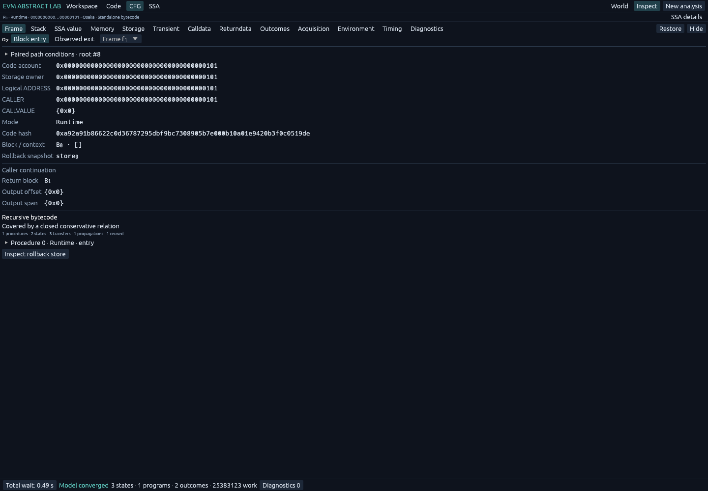

# 世界未知部分怎样参与执行

分析器知道 A 的 bytecode，却不知道 A 调用的 U 会做什么。现在它可以为 U 建立一个抽象交互过程：覆盖不调用任何已知账户的执行，也覆盖反复进入已知 A、C、继续调用其他未知部分、接收结果并最终成功或失败的执行。

这里的“未知”描述当前掌握的信息。它既可能是符号 target 的未覆盖地址，也可能是地址确定而代码尚未取得的账户。需求与讨论见 [#124](https://github.com/ethever/evm-abstract-lab/issues/124)；符号状态与求解器的分工见 [#111](https://github.com/ethever/evm-abstract-lab/issues/111)，递归与预算背景见 [#123](https://github.com/ethever/evm-abstract-lab/issues/123)。

## 1. 先看一条完整执行链

```text
A 的实际指令：CALL target
    │
    ├─ target = A        → A 的实际入口
    ├─ target = C        → C 的实际入口
    ├─ 已知空执行/原生目标 → 相应 EVM 执行规则
    └─ 其余目标          → 未知交互过程 U
                              │
                              ├─ 保守内部效果
                              ├─ 调用已知入口 → 执行实际代码 → 接收返回
                              ├─ 再进行交互，包括嵌套的已知/未知调用
                              └─ Return / Revert / Failure
    ← 恢复 A：成功位、returndata、输出区、共享状态
```

候选分支按 EVM 的低 160 位地址投影建立相等条件，剩余分支带上排除已覆盖目标的条件。不能因为已经分析 A、C 就删掉余下地址。用于保存未知 owner 状态的内部命名空间，也不是观测到的链上地址；ADDRESS、CALLER 的值另外保留，不拿内部名字去补查 RPC 或计算创建地址。

U 的内部效果与已知入口执行各有职责。普通 CALL 进入不同 owner，U 自己的写入不会直接覆盖已知 A、C 的 storage；若 U 要通过 C 修改 C，就要分析 C 的实际入口和条件。无法枚举的其余世界状态使用较宽的保守效果。DELEGATECALL、CALLCODE 则允许未知行为在当前 owner 上执行，因此可以直接改变该 owner 的 storage。静态上下文禁止状态修改，并继续约束其子调用。

未知过程在当前 owner 上委托执行已知代码时，其 owner 内部效果已包含在允许的任意内部行为中；若这段执行继续普通调用另一个已知 owner，则由相应真实入口的交互关系覆盖。因此不另外枚举一份仅在未知 owner 上执行的已知代码副本。这是显式的精度取舍：它不据此新增覆盖过的指令块，也不允许直接改写其他已知 owner 的 storage。

栈和 memory 仍属于各自的 frame。U 返回后，A 的旧栈值继续保留；CALL 只按其规则更新成功位、returndata 和指定输出区。输出区复制长度为请求长度与实际 returndata 长度的较小者，未覆盖的后缀不能被清零或任意改写。

## 2. 多次回调：为什么一次不够

[busy-x.json](../examples/unknown-world/busy-x.json) 提供 A 的完整 bytecode，U 的地址为 `0x201`，代码没有提供。A 的 slot 0 是 busy，slot 1 是 x；calldata 的第一个字选择实际入口分支。

```text
run（selector=0）:
    busy 非零时 REVERT
    busy = 1；x = 0
    CALL U
    保存当时的 busy，随后 busy = 0
    RETURN 两个字：x、保存的 busy

one（selector=1）: x = 1；STOP
two（selector=2）: 如果 x == 1，写 x = 2；STOP
其他输入: STOP
```

| U 成功返回前的交互 | x 的可能值 | busy |
| --- | --- | --- |
| 零次回调 | `{0}` | `1` |
| 至多一次回调 | `{0,1}` | `1` |
| 至多两次回调 | `{0,1,2}` | `1` |
| 继续回调 | `{0,1,2}` | `1` |

`one → two` 才能产生 2。回调 run 会被 busy 检查阻止，失败的回调不意味着 U 整体失败；U 可以处理失败后继续。外层 A 恢复后清除 busy，返回的数据中仍能观察清除前的 1。

从仓库根目录运行：

```bash
nix run . -- analyze \
  --world examples/unknown-world/busy-x.json \
  --evm.to 0x0000000000000000000000000000000000000101 \
  --evm.caller 0x0000000000000000000000000000000000000900 \
  --evm.value 0 --evm.calldata 0x \
  --format json > /tmp/unknown-busy.json

jq '.status, .procedure_summaries[] |
    if type == "object" then
      {closed, state_count, transfers, propagations, reused}
    else . end' /tmp/unknown-busy.json
```

空 calldata 的读取补零，因而这次外层输入选择 run；U 对 A 的回调输入仍是未知。检查结果时分开看 `Return` 与入口立即失败等其他 outcome。`Return` 的第一个字覆盖 `{0,1,2}`，第二个字为 1；外层最终 slot 0 为 0。返回值检查用 [`unknown_world/interactions.rs`](../crates/evm-abstract/tests/unknown_world/interactions.rs) 的 `output_word`，它读取完整 byte array 表达式，而不是只读 JSON 中的稀疏字节缓存。

[busy-x-nested.json](../examples/unknown-world/busy-x-nested.json) 还增加了 selector=3 的真实分支 `CALL 0x401`。因此可形成 `U → A.three → U' → A.one/two/three → …`。它与基础例子使用同一组状态精度要求；摘要中还应出现 U' 的依赖以及实际执行过的 three 块。

## 3. 没有重入 A，世界仍会变化

[external-change.json](../examples/unknown-world/external-change.json) 包含 A 和 C 的代码。C 在 `0x301`，初始 slot 0=5，slot 1=1；slot 1 控制 C 是否允许把 slot 0 写成 9。

```text
A 调用 C 的读取分支 → C 执行 SLOAD → 返回 5
A 把 old=5 保存到自己的栈
A 调用未知 U
    U 可以进入 C 的写入分支
    C 检查自己的 slot 1，允许时写 slot 0=9
U 返回
A 再次调用 C 的读取分支 → 返回 5 或 9
A 返回两个字：old、new
```

A 的 SLOAD 不能直接读取 C.storage；两次读取均由 C 执行。固定区块或离线 world 提供初始事实，执行中的 Store 记录后续修改。old 保持 5，new 覆盖 5 与 9。

把上面命令的 world 换成 `examples/unknown-world/external-change.json`，其余入口字段不变。[external-guard.json](../examples/unknown-world/external-guard.json) 则只把 C 的初始 slot 1 改成 0：C 的实际入口检查阻止写入，两次返回都应保留 5。这个对照用于检查分析器确实执行了 C 的条件，而不是无区别丢掉 C 的全部状态。

## 4. 成功效果仍受外层回滚控制

| 执行情况 | 应保留的状态 |
| --- | --- |
| C 成功，U 成功，A 成功 | C 的写入可保留 |
| C 成功，随后 U REVERT | 恢复进入 U 前的状态 |
| U 成功，随后 A REVERT | 恢复进入 A 前的状态 |
| 一次 C 回调失败，U 处理结果并继续 | 恢复该次回调的状态，保留更早的成功效果 |

[outer-revert.json](../examples/unknown-world/outer-revert.json) 把 A 的最后 RETURN 改成 REVERT。回退数据仍可展示执行期间保存的 old/new，但最终 C.slot 0 恢复为 5。回滚的数据状态、returndata、执行成本有各自规则，不能统称为全部恢复。

内部摘要求解中的 procedure 结束也不等于整个交易结束。创建和 SELFDESTRUCT 的延迟生命周期效果，必须由真正的外层交易结束处理。已知代码中的创建若仍缺少必要事实，保留相应前沿；未知内部行为的创建等效果只能在其声明的保守范围内使用。

## 5. 这里如何求闭合

实现位于 [`analysis/transfer/procedure.rs`](../crates/evm-abstract/src/analysis/transfer/procedure.rs)。它把未知过程和进入的已知过程放在同一张关系表中，输入、块状态、结果和调用依赖共同增长。一次新的递归调用订阅 callee 的结果，并保存自己的 continuation 与回滚检查点；callee 出现新结果后，所有相关调用点重新传播。

摘要的长期表示保留数值上界，不以整段调用栈、旧 Store 表达式树或某个具体 SMT 赋值作为新的过程身份。每次执行时从摘要产生独立的符号数组与值。代价是过程边界处会丢失一部分输入输出关系；这些结果是保守覆盖，不能当作唯一的实际轨迹。

静态未知过程可以直接使用状态恒等关系、任意返回／回退数据和异常失败的效果上界。静态限制传递给子调用，因此只读回调不会修改当前建模的 storage、transient storage、余额、代码、生命周期或日志。未知过程可以忽略回调结果并自行选择返回数据，所以这个上界也覆盖零次、多次和嵌套只读回调；无需再展开已知代码来扩大它。报告只记录这份未知过程摘要，不给省略的回调虚构已执行块。

这项简化针对当前建模的状态和返回效果。执行器目前没有逐指令追踪剩余 gas、访问预热和退款，不能据此认为具体静态调用不改变这些资源状态。摘要构造、返回复制、取消和预算检查仍然执行，已经产生的诊断或前沿也不会被删除。非静态未知过程仍需通过已知代码的真实入口约束对受保护账户的修改。

闭合所依赖的条件如下，队列为空只是最后的调度结果：

1. 初始输入和基本成功／失败行为已经进入关系；未覆盖的效果不能被静默省略。
2. 对效果上界尚未完整覆盖的已知入口按真实 bytecode 执行；未知过程按声明的效果范围与交互规则传播。静态过程使用上述完整上界。
3. 输入上界增大时重新执行；callee 输出增大或 continuation 上界变化时，重新传播对应返回。
4. join 保留已发现行为；持续增长时采用保守 widening。比较完整摘要，包括数组默认值、未列举账户、生命周期和结果类别，不能只比较稀疏缓存或 x。
5. 没有未处理依赖或前沿，继续一轮上述传播也不增加摘要。

这给出的是当前抽象域中的归纳上界，不承诺最精确的输入输出关系。有限集合能稳定时，join 就足够；widening 不要求每次调用都发生。SMT 仍负责实际执行中的条件检查和关系推理，UNKNOWN 不会被当成 UNSAT。这个实现使用 worklist 和现有关系域，没有要求引入独立的 Horn 后端。

[static-reuse.json](../examples/unknown-world/static-reuse.json) 让 A 连续四次 STATICCALL 未知 U，最后返回未被修改的 slot 0=42，可用于开启／关闭复用的同输入对照。

`--no-summaries` 关闭外层不同调用之间的复用；一次未知交互内部仍必须完成递归闭合。否则开关会改变被覆盖的行为，而不只是改变性能。

### 已知代码自身递归也进入同一过程表

已知代码不必先调用未知目标，才能使用这套收敛机制。普通执行在新子调用入口检查：当前代码身份、storage owner、逻辑 ADDRESS 和静态模式，是否已经出现在暂停的祖先中。出现重复时，把这个子调用放入相对过程表；普通非递归调用继续保留逐指令图与精确调用证书。

```text
原来的展开位置：[A] → [A,A] → [A,A,A] → …
现在的递归关系：A 的输入上界 → 执行 A 的 bytecode → 更新 A 的输出上界
                                    ↑                    │
                                    └── 调用依赖与返回 ───┘
```

重复身份只决定在哪里启用递归分析，不证明两次完整输入相同。calldata、CALLER、CALLVALUE 和共享状态仍参与过程分析与输入合并。CALL、DELEGATECALL、CALLCODE 仍按真实上下文规则执行；每个调用者分别保留继续位置、私有状态和回滚检查点。新结果出现后，再传播给等待的调用者。

过程输入持续增长时，widening 的启动轮数由独立策略决定，不沿用“最多保留多少个常量”的容量。否则 Web 的 512 个常量容量会让递增值等待很多轮。扩大区间时，也要去掉仅由旧区间隐含的位约束，避免下一次归约把区间重新缩回去；仍然成立的独立约束，例如目标地址已确定的低 160 位，继续保留。稳定的小型有限集合也不因其他字段增长就被直接扩大成任意值。

多个前驱汇入同一块，本身并不表示存在循环。例如四处代码把不同返回 PC 压栈，再跳到同一个子程序：这四个地址应该先通过 join 保留。过早 widening 会扩大返回目标，甚至使原本不可达的 JUMPDEST 进入分析。过程内用实际控制流边确认循环反馈，递归调用则用过程依赖确认反馈；两者分别决定需要加速收敛的位置，不把每次输入更新都当作循环迭代。

同一个 frame 内连续或嵌套调用公共子程序，还需要区分最近经过的跳转位置。过程表保留 `context_depth` 范围内最近的不同跳转源：例如 `[a,b,c,b]` 归一化为 `[a,c,b]`。这样既保留最近的调用位置，又不会因为循环重复经过同一位置就不断增长历史。每个新 frame 仍从空历史开始，不用整条外部调用栈区分递归实例。顺序调用、嵌套调用和真实计数循环的回归共同检查这项取舍；`context_depth=0` 仍允许合并这些位置，不承诺相同精度。复杂路径也可能产生很多不同排列，因此状态和 work 预算继续生效。

CALL 返回后的第一个基本块按成功位 0 / 1 分开传播，随后恢复普通合并。这样后续指令检查成功位时，成功返回的数据不会被失败路径未覆盖的旧内存污染。这是有限的调用继续状态划分，普通图、递归过程和精确调用证书回放都保留它；不把任意栈值或调用深度放进新的状态键。

这仍不意味着任何符号入口都能立即分析完成。过程输入、结果和调用依赖可能需要多轮传播，实际 bytecode 还会产生分支与 SMT 查询。有限数值集合的 SMT 编码直接使用经过所有数值约束过滤后的成员关系，避免为同一集合再加入昂贵的冗余余数公式；它不删除该集合允许或排除的值。是否改善完整请求耗时，必须用同一输入和策略测量。

例如一段 A 的代码总是调用自己，随后忽略成功位并返回 42。具体执行中，子调用可能因资源或深度限制被拒绝；A 从真实的 CALL 后续指令继续，仍返回 42。抽象过程保留这个调用失败分支，因此递归结果可以从这些实际指令开始建立，再向调用者传播。不能等所有子调用先算完才发布结果，也不能把尚无返回结果的递归当成已经成功。

过程表抽象掉绝对调用深度，保留 CALL 的失败和可进入分支。这会允许比具体深度限制更早的拒绝或更长的成功链，是明确的保守近似。`max_call_depth` 控制尚未归并的实体帧；如果达到预算时还没有形成可归并的入口，仍报告 `CallDepth`。它不是 EVM 的失败返回值。若递归过程稳定后仍没有被覆盖的终结行为，报告 `RecursiveNoTerminal`，不以空结果宣称闭合。当前逐指令 gas 精度边界仍适用。

已知递归与未知交互都导出到 `procedure_summaries`，其中 `kind` 分别为 `KnownRecursion` 和 `UnknownEnvironment`；`root_procedure` 指明本次请求的入口。已知过程保持 Runtime 身份，并记录实际求解过的块。主图上的摘要返回表达调用效果，不生成一份虚构的完整逐层执行轨迹。`--no-summaries` 同样不会关闭已知递归内部的固定点求解。

## 6. 怎样从报告读到这些区别

| 内容 | native JSON | Web／文本中的含义 |
| --- | --- | --- |
| 实际展开代码 | `states`、指令执行证据 | 已捕获的实际指令与块 |
| 未知过程 | frame `mode: "Unknown"` | Abstract environment，没有虚构指令 |
| 已建立的递归／交互效果 | `procedure_summaries` 与 `Summary` 边 | 已知递归或未知交互摘要与成功／回退／失败返回 |
| 摘要内部实际执行的已知块 | procedure `covered_blocks`、代码身份 | 过程级覆盖来源，不冒充主图展开轨迹 |
| 尚未完成 | `frontiers` 与 `closed: false` | 真实预算／状态／效果缺口 |

协议报告把摘要投影为 `abstract_summaries`，包含入口 state、过程依赖、块覆盖和迭代计数。Web 可在对应节点的 inspector 中查看。native JSON 则保留过程输入和结果 Store；这两种报告的 schema 版本分别为 native 8、Web protocol 12。

native 8 将旧 `unknown_summaries` 统一为 `procedure_summaries`；Web protocol 12 新增摘要的 `kind` 和 `root_procedure`。消费者应按版本同步迁移。Web 的已知递归节点显示 Recursive bytecode summary，Frame inspector 显示 Recursive bytecode；未知过程继续显示 Abstract environment／Abstract interactions。

下面是 `self-return-42.json` 的真实 Chromium 检查截图。选中的仍是有代码哈希、storage owner 和 caller continuation 的 Runtime frame；下方记录其递归过程已经闭合。这是小型递归语义与界面的验证，USDC 性能须单独测量。



分析仍受累计 work、状态数、transfer、表达式、memory 等预算约束。中断时已经可靠得到的结果可以继续展示，但不能把没有处理完的交互标成 closed。也不能把最后一次访问过的旧状态当作当前合并后全部输入的代表。

## 7. 验证范围

[`unknown_world`](../crates/evm-abstract/tests/unknown_world.rs) 同时检查抽象结果、guard、上下文、回滚和报告，并用 revm 执行提供了具体 U bytecode 的有限样本。具体样本包括零次、连续多次、间接和嵌套回调。具体结果落入抽象结果可以发现遗漏，但不能替代前述一般覆盖条件。

基础回调、嵌套回调、C 的变化与禁止写入、回滚和短返回数据用库的默认策略验收。完整符号地址空间还包括各原生目标；目标条件与重复地址身份测试使用显式更大的统一策略，另有默认预算耗尽的前沿测试。两个不同符号 target 的别名例子中，某些原生目标仍要求具体输入，因此报告保留 `PrecompileInput`。如果这种缺口出现在 U 调用的已知代码内部，U 的关系也保持 open；可用的 C→C 别名具体见证并不能证明整个世界已经闭合。

性能比较必须使用相同输入、行为假设、覆盖范围和精度要求。除了耗时，还要记录累计 work、过程与状态数量、传播／复用次数、frontier、导出体积和峰值内存。基础例子与变化状态的例子需要分开观察；更多 `reused` 不自动意味着整个请求更快，也不能用缩短预算后的提前停止宣称性能修复。

[`benchmark-unknown-world.py`](../scripts/benchmark-unknown-world.py) 在干净提交上交替开启／关闭复用，验证完整覆盖和返回值精度后才记录成功样本。测量包含 CLI 分析和 JSON 导出；要求传入由该提交新构建的 release 二进制，并使用新的输出目录。库测试和 CLI 的求解预算不同，不能直接比较两者的计费 work；work 也不等于求解器实际步数或毫秒。

本次 43 个测试、六份示例、同精度 release 对照和独立原生 SMT 成本记录见 [Issue #124 验收与性能](issue124-validation.md)。其中明确区分库默认预算、CLI 测量策略，以及保留 open 的原生输入和创建边界。

普通已知递归的具体执行见证、原始 USDC / WETH 请求与独立复现命令见 [已知递归验收与性能](known-recursion-validation.md)。[自调用返回 42 的示例](../examples/known-recursion/README.md)用于理解递归结果如何从实际 CALL 失败后的继续执行开始建立。

返回[课程导航](../README.md#验证与源码导航)，或继续阅读[符号与关系域](15-symbolic-relations.md)。
