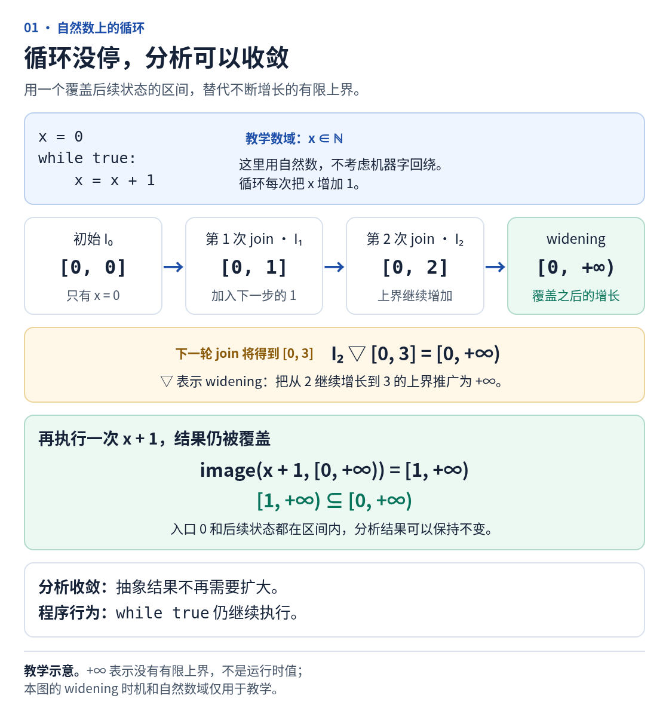
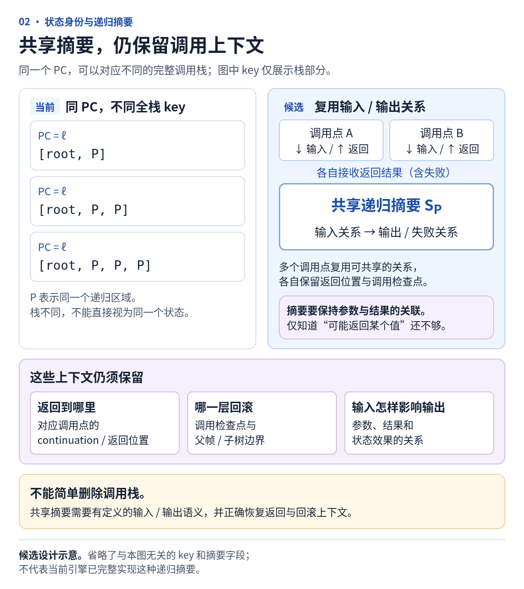
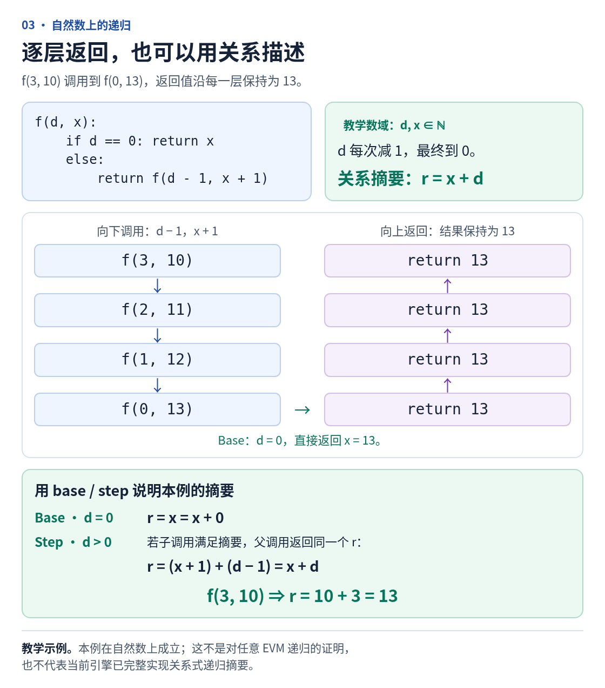
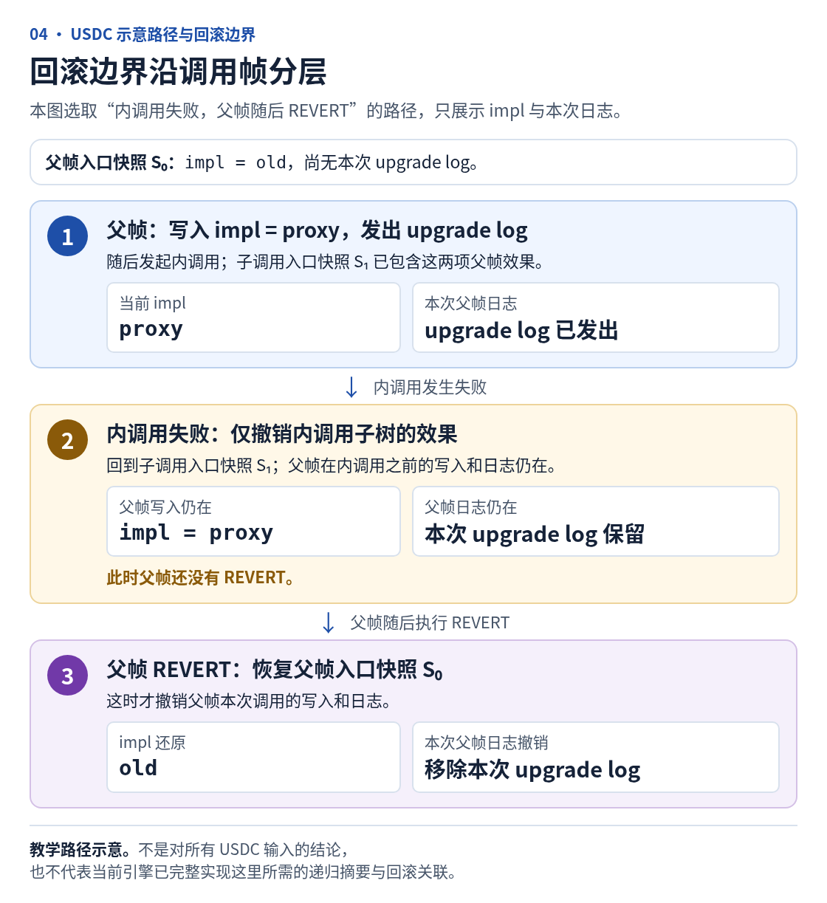

## 问题与目标

PR #119 让未知长度数据复制与调用路径能够继续分析，同时暴露了 USDC 默认未知输入分析中的深层递归与资源增长。PR #122 已降低重复 SMT 查询和状态复制成本，但没有解决递归展开本身。本 issue 记录后续两条可以并行推进的路线：

1. **递归调用的摘要与收敛**：减少重复展开，在声明的输入和 EVM 模型下给出有依据的调用结果与效果。
2. **资源预算与部分报告**：在未能及时收敛时，及时、准确地交付已建立的结果和未展开前沿，避免 Web 长时间只有运行状态或因内存耗尽失去全部结果。

继续沿用 #111 的决定：**分析器负责 EVM 语义、抽象状态和递归关系建模，使用 SMT 及适合的已有求解能力求解/验证。** 不自行实现通用 SMT 求解器，不预设 ERC-1967、固定实现槽、ABI、USDC 地址或代理标准。

本 issue 规定行为、正确性、性能与验收要求，不把数据结构、抽象域、摘要形式、widening 策略、阈值、provider 或实施顺序写死。可以分阶段实现；下面的算法和公式是候选说明，不代表已实现。

## 阅读方式

本 issue 同时保存讨论结论、直观教学和后续实现要求。先读“讨论记录”了解已经决定的分工，再读“教学补充”从小程序理解 widening 与递归摘要，最后按两条路线的要求实施和验收。四张图都是普通 PNG，不依赖交互可视化；每张图旁都保留 Markdown 表格、代码或文字说明。

**这里的核心结论：递归可以借助 widening 收敛；需要先有正确的递归关系/上下文表示，再验证摘要的覆盖和闭合。预算与部分报告负责尚未收敛时的可用性，两条路线可以并行。**

## 讨论记录与已经明确的决定

这部分把前面围绕 #111、PR #119 性能退化、USDC 递归和 widening 的问答收拢起来。表内包含提问归纳和讨论中澄清的边界，并非逐字转录。下文的教学图及玩具程序用于解释概念；实现要求仍以语义、可验证结果和验收为准。

| 讨论的问题、归纳或更正 | 目前的结论 |
| --- | --- |
| 不是已经决定自己建模，使用 SMT 求解吗？ | 是。分析器定义 EVM 状态、指令、调用上下文、数据来源与效果，再将关系交给 SMT 求解或验证。这个决定没有改变。 |
| 求解规则是不是就不用我们自己写？ | 不自己写通用 SMT 理论求解算法；但 EVM 操作如何变成约束、递归关系如何表示、何时合并/扩大、怎样解释 UNKNOWN，仍需由分析器或接入的固定点框架负责。普通 `check-sat` 不会自动补齐这些。 |
| 符号数据表示、状态读写关系和 SMT 是不是只做其中一个就够？ | 它们分别回答数据怎样保存、EVM 怎样变化、关系如何求解，可以协作。引入求解器不会自动替代前两者，也不要求三套重复实现或全量重写；#111 已改为能力要求，具体表示和后端选择由实现者决定。 |
| 代理合约的 storage 怎么办？ | 以 bytecode 中的调用指令及上下文建模。代码账户和状态账户分开，不能假设 ERC-1967、固定 implementation 槽、代理 ABI 或特定地址。SMT 推导已建模关系，不能凭空补出未知代码或链上事实。 |
| CALLCODE、CREATE、CREATE2 是否也有特殊之处？ | 有。四种 CALL 的上下文、static、value 与回滚规则分别处理；创建还涉及当前状态账户作为 creator、地址推导、nonce、initcode 与 runtime code 的区别，以及失败和外层回滚。完整要求保留在 #111；本 issue 的递归摘要必须遵守这些边界，不能把运行时代码摘要直接套到 initcode。 |
| SSA 块之间还是通过栈传递，这是参数吗？effect 又是什么？ | EVM 执行仍按栈语义；SSA 可以把边上传递的栈值表示为边实参和目标块参数。effect 表达有状态操作的先后与依赖，例如一次读取依赖哪个状态版本；effect 编号自身不证明 slot 别名或读取值。调用摘要也要保留返回值、状态效果和来源关系。 |
| 是不是 PR #117 导致这次性能退化？ | 已更正为 PR #119。用户复现条件是 Web 内置 WETH/USDC 地址、calldata 留空和默认设置；留空对应 Unknown 输入。PR #122 优化了部分求解与复制成本，USDC 深递归尚未解决。 |
| USDC 有哪两条解决路线，是否只能选一条？ | 递归摘要/收敛减少重复分析；资源预算/部分报告保证尚未收敛时仍能受控停止并交付已有信息。两条可以并行，也分别验收。提前停止不等于递归问题已经解决。 |
| 这种递归能不能通过 widening 达到不动点？ | 可以。先建立能反复更新的抽象位置或递归输入输出关系，再用 join、必要时 widening 等方式求保守摘要，检查它覆盖入口、基本分支和递归转移。不是只能写精确递归证书。 |
| 发现同地址、同 PC 或相同 calldata，就可以不再展开了吗？ | 这些只是识别候选的线索。还要处理 caller/value、storage owner、状态变化、返回位置、剩余深度、gas 及回滚；不同完整调用栈目前也对应不同 key。不能仅删除栈或深度后直接复用。 |
| 用了 widening 就表示分析未完成吗？ | 不一定。已经建立、覆盖声明模型内行为的保守摘要可以收敛，只是可能不够精确。尚未闭合、未覆盖或触发预算的路径仍是 frontier；其他分支未完成时，整个请求仍为 Incomplete。 |
| issue 不要把实现写死。 | 保留这一要求。下面公式、图片、深度参数化和 Horn/PDR 都是解释或候选；不强制特定抽象域、算法、阈值、provider 或一次性交付顺序。 |

### 用户反馈与复测要分开看

用户最初反馈：USDC 在 Web 端接近 1000 秒仍未返回；WETH 约 361 秒结束，出现 57 条 abstract-state diagnostic entries 和 1 个 unexpanded frontier。随后确认使用内置地址、calldata 留空、其余默认，并把归因从 PR #117 更正为 PR #119。这些是用户当时看到的现象。

后续固定区块复测中，PR #122 最终候选对应的 WETH 处理时间约 24.268 秒，0 条诊断，仍有原先的 1 个 UnknownTarget 前沿，因此报告仍为 Incomplete。USDC 则仍在约 363 秒触及实验外部内存保护线，未得到报告。两者是不同请求和结果，不能因为 WETH 改善，就宣称 USDC 也已经解决；候选上的改善也不等于用户部署已经更新。固定条件、证据边界和 USDC 深度诊断见下文。

## 两条路线如何一起工作

假设一个请求同时包含普通路径、能够建立摘要的递归路径，以及暂时无法总结的状态变化路径。普通路径照常分析；能建立摘要的递归路径通过摘要覆盖后续行为；剩余路径继续工作并受任务预算约束。到达预算后，从安全检查点发布已有图、结论和待展开前沿。

| 场景 | 摘要/收敛路线提供什么 | 预算/部分报告路线提供什么 |
| --- | --- | --- |
| 对某个递归输入域已经建立可靠摘要 | 用已验证关系覆盖其后续调用，减少逐层展开与状态/图复制 | 控制同一请求的其他路径，以及编码、求解、RPC 和报告生成开销 |
| 递归仍在变化，尚未建立可靠摘要 | 继续改进候选；保持未闭合状态，不猜测调用结果 | 到达资源边界时说明停止原因，交付安全的已知结果和 frontier |
| 求解器返回 UNKNOWN 或某类关系不支持 | 不把它当成 UNSAT，也不当成“摘要已经成立” | 明确保留未知原因；是否继续其他工作由任务策略决定 |
| 预算已经耗尽 | 不以“没有再展开”冒充收敛 | 在预留资源内生成/发布部分报告；无法取得安全快照时如实报告失败 |

这里没有承诺“开启 widening 就能让全部 Unknown USDC 输入迅速完整分析”。要验证的是：适合总结的递归确实能被总结，不能总结的部分也不会让 Web 无限等待或丢掉所有已有信息。

## 已有证据与归因边界

本轮源码基准：`6652d7de3f479cf76542412c7b4b194a4a9d69a6`（PR #122）。固定 Ethereum 区块 `26180958` / `0x5219691ff60b20005fa597d2bb5e4b11e3ddb68f24fb528a900c8dafbb84b499`；地址 `0xA0b86991c6218b36c1d19D4a2e9Eb0cE3606eB48`，Web 内置地址、calldata/caller/value 均 Unknown、其余默认配置。calldata 留空表示内容及长度未知，不等于空字节 `0x`。原始 USDC 请求 SHA256 为 `df1a7eae163963b18e83c7413eb77d6da65381d19b3d2232f02d2f0ad90c6c4e`。

- 旧核心的同块 USDC 约 6.7 秒返回，但已经留下 7 个 Memory 前沿，相关路径没有展开；不能把它当作相同覆盖度的完成时间。
- PR #122 最终 release 候选约 363 秒、1519 states / 1410 transfers 时触及测试脚本设置的 8 GiB RSS 保护线，主动停止，没有终态分析报告。8 GiB 是外部实验守护，不是产品默认限制；不能写成 solver 超时或完整分析。
- 独立的 120 秒深度日志诊断观察到最多 30 个活动/挂起帧，即 call depth 29；新增最大深度事件的 active code 都为代理自身的 PC0。第三帧以后，每新增一层间隔 13 transfers。它按诊断时限取消，没有最终报告；不能外推此前 363 秒请求的最大深度，也不能仅凭日志证明每层完整状态相等。
- 捕获字节码允许管理员把 implementation 改为代理自身，随后 self CALL；该子帧 caller 变为代理，进入 fallback，再 DELEGATECALL 到自身。对一部分输入，后续转发保留 calldata、caller/value 与共享状态，主要增长来自调用栈及剩余深度变化。具体 100-byte 输入 witness 已根据字节码构造，但尚未作为独立具体执行回归运行；需要在实施时验证。
- 这不是“代理调用自身就一定不可行”。没有发现能合法排除全部上述递归的上下文重置错误。地址候选分支缺少相等 guard 是另一个精度改进点，尚未验证其对本轮性能的影响；它也不能排除 implementation 确实等于代理的输入。

原始记录保存在本地 `.evidence/perf119-20261013/`：`final-performance-aggregate.json`、`performance-findings.md`、`depth-diagnostic-usdc/depth-findings.json`、`usdc-recursion-review-6652.md`。这些本地路径不是公开下载链接。PR #122 包含性能与验证摘要；本 issue 的性能数字属于单次固定输入样本，不是延迟分布或未来性能承诺。

## 当前为什么没有收敛

- [MachineKey 保存整个调用栈](https://github.com/ethever/evm-abstract-lab/blob/6652d7de3f479cf76542412c7b4b194a4a9d69a6/crates/evm-abstract/src/analysis/machine.rs#L92-L98)。同一代码在更深一层执行，会产生不同的结构键。
- [Engine 只有命中同一个 key 才执行 join_cyclic](https://github.com/ethever/evm-abstract-lab/blob/6652d7de3f479cf76542412c7b4b194a4a9d69a6/crates/evm-abstract/src/analysis/engine.rs#L621-L705)。新的 key 创建新的节点，因此现有 widening 不会自动把不同递归深度合成同一个调用摘要。
- [当前栈标量 widening](https://github.com/ethever/evm-abstract-lab/blob/6652d7de3f479cf76542412c7b4b194a4a9d69a6/crates/evm-abstract/src/analysis/machine/join/widening.rs#L1-L62)要求其余 payload 形状及内容保持一致；它不能单独解决增长的调用栈、状态版本或回滚历史。
- [现有 SummaryInput](https://github.com/ethever/evm-abstract-lab/blob/6652d7de3f479cf76542412c7b4b194a4a9d69a6/crates/evm-abstract/src/analysis/summary.rs#L39-L76)包含完整输入状态和 remaining_call_depth，[lookup 使用完整相等](https://github.com/ethever/evm-abstract-lab/blob/6652d7de3f479cf76542412c7b4b194a4a9d69a6/crates/evm-abstract/src/analysis/summary.rs#L332-L351)，而[候选仍有待处理节点/前沿时返回 Pending](https://github.com/ethever/evm-abstract-lab/blob/6652d7de3f479cf76542412c7b4b194a4a9d69a6/crates/evm-abstract/src/analysis/summary.rs#L530-L568)。这是已完成调用图的精确复用，不是递归摘要方程的固定点求解。
- [现有摘要复用还会实例化完整调用图](https://github.com/ethever/evm-abstract-lab/blob/6652d7de3f479cf76542412c7b4b194a4a9d69a6/crates/evm-abstract/src/analysis/summary.rs#L1-L8)。减少 SMT 查询后，逐层状态与图的复制仍可能继续增长。

## 教学补充：从具体执行理解 join、widening 和递归摘要

下面用两个小程序解释本 issue 要解决的问题，再对应到 USDC。小程序使用**没有溢出的自然数**，不是 EVM 的256位算术，也没有模拟gas；图中的栈只是结构示意。例子用于说明行为和正确性要求，不要求实现采用某个区间域、widening时机、摘要格式或求解后端。

### 1. 先看普通循环：执行中的一个值，分析中的一组可能值

```text
x = 0
while true:
    x = x + 1
```

一次具体执行中的x依次是 `0、1、2、3……`。静态分析不是只记录最新的一个数，而是在**同一个循环入口**记录“到这里时，x可能是什么”。用区间表示已有发现：

| 当前循环入口描述 | 执行一次 `x=x+1` 得到的范围 | 把旧入口和新到达的值合并 |
| --- | --- | --- |
| `[0,0]` | `[1,1]` | `[0,1]` |
| `[0,1]` | `[1,2]` | `[0,2]` |
| `[0,2]` | `[1,3]` | `[0,3]` |

`[0,1]`的意思是“x可能为0或1”，不是x同时等于两个数。表中第二行执行的是抽象描述中的所有可能值：0可以变为1，1可以变为2，所以新到达的范围是 `[1,2]`。

这里的 **join** 就是把旧发现和新发现放在一起，用一个描述包住它们。对于本例，join没有漏掉旧值，也没有跳过新值；问题是上界会一直增加，单靠这个过程没有有限的停止点。

### 2. Widening 怎样让描述停止增长

一种常见的区间widening候选做法是：发现上界持续增长后，直接把它扩大到没有上界。例如先得到 `[0,0] → [0,1] → [0,2]`，下一次合并本应得到 `[0,3]`，此时扩大为 `[0,+∞)`。图1采用这个时机只是为了展示过程；实际实现可以延迟、使用阈值或其他策略。

```text
已发现：0、1、2；下一步还会到达3
保守扩大：[0,+∞)
继续执行一次：得到 [1,+∞)
再合并入口初始值0：仍是 [0,+∞)
```

`+∞`是“这个描述不设置有限上界”，不是程序中出现了一个值叫无穷大。`[0,+∞)`包含所有已经发现的值；执行循环体后仍没有值跑出这个范围，所以可以继续使用同一个描述。

这就是一个**入口不变量**：每次到达循环入口，x都在该范围内。为了相信它，需要同时检查“起点0在里面”和“从里面执行一步仍在里面”。只看到两次数字一样，或者求解器暂时没返回，并不足以建立这个结论。

用前文的符号，`F#`表示“加上初始入口，再执行一步并合并”的抽象变换。我们要确认 `F#(I) ⊑ I`：I已经覆盖再次展开可能得到的内容。可以把它理解为“这个包不会被下一步撑破”。这是归纳闭合的保守上界，通常称为post-fixpoint；widening不保证求到最小、最精确的那个答案。[理论依据：Cousot & Cousot，命题6.17](https://www.di.ens.fr/~cousot/publications.www/CousotCousot-JLC-n2--3-p103--179-1992.pdf)



图1：范围覆盖自然数执行的可能值；分析描述稳定不代表程序停止。

**此时分析可以停止反复扩大范围，玩具程序却仍在无限循环。** “分析收敛”说的是描述已经稳定且覆盖行为；“程序终止”说的是执行最后会停止，两者不是同一件事。这个无条件循环的自然数例子也不等于“真实EVM可以无限消耗gas”。

在这个 `+1` 的自然数例子中，所有非负整数都会到达，`[0,+∞)`恰好覆盖它们；widening并不必然在每个例子里损失精度。若把循环体改成 `x=x+2`，实际只会到达 `0、2、4、6……`，区间 `[0,+∞)`还包含1、3等奇数。它没有漏掉真实值，因此仍是保守结果，但已经丢失“只可能为偶数”的精度。这里奇偶精度的损失并非只由 widening 引起：用区间 join 表示 `{0,2}` 为 `[0,2]` 时，就已经包含了1。这个例子也说明抽象域的表达能力会影响精度。不能把这些多包含的可能值说成真实执行过的值。

### 3. 再看有限递归：先逐层执行，暂时不谈摘要

```text
f(d, x):                    # d、x都是自然数
    if d == 0:
        return x
    return f(d - 1, x + 1)
```

这里d是这个**玩具函数自己的输入参数**，决定还要做几次递归；它不是分析器的work预算，也不是EVM gas。

从 `f(3,10)`开始：

```text
f(3,10)
  调用 f(2,11)
    调用 f(1,12)
      调用 f(0,13)
      返回13
    返回13
  返回13
返回13
```

| 当前参数 | 当前完整调用栈示意 | 当前发生的事 |
| --- | --- | --- |
| `(3,10)` | `[f]` | 最外层等待子调用 |
| `(2,11)` | `[f,f]` | 再增加一层等待 |
| `(1,12)` | `[f,f,f]` | 再增加一层等待 |
| `(0,13)` | `[f,f,f,f]` | 到达基本分支，返回13 |

每层有自己的参数和返回位置。栈里虽然反复出现相同函数名，它们也是不同调用帧。表中的参数是调用数据，不是在声称当前项目的MachineKey把参数值当成字段。

### 4. 为什么项目现有 widening 不会自动合并这些层

普通循环的多个入口值会回到同一个位置，因而有地方把它们join。当前分析器对调用状态的“位置”还包含完整调用栈：`[f]`与`[f,f]`长度不同，因此形成不同的结构键。

[当前MachineKey保存全部帧](https://github.com/ethever/evm-abstract-lab/blob/6652d7de3f479cf76542412c7b4b194a4a9d69a6/crates/evm-abstract/src/analysis/machine.rs#L92-L98)，[Engine只有命中同一key才进行join/widen](https://github.com/ethever/evm-abstract-lab/blob/6652d7de3f479cf76542412c7b4b194a4a9d69a6/crates/evm-abstract/src/analysis/engine.rs#L627-L707)。同一段代码进入更深调用时，分析器先创建新节点；它们还没有在同一个入口上相遇，不能靠调整一个数值widening阈值解决。

递归摘要或适当的上下文抽象，要为这些调用提供一个共同的计算位置：在这里总结“f接收什么输入，可能产生什么结果”。父调用的返回位置和局部状态仍要另外正确保留；不能仅删掉完整栈，就让子调用返回到任意父帧。共同位置也不一定只是函数名或代码地址，仍可能按必要的上下文条件分区。



图2：共享摘要总结调用关系；不同帧的参数和父调用返回位置仍需正确处理。

### 5. “知道入口范围”还没有回答“调用会返回什么”

对玩具f，可以知道每层入口的x都非负。这个入口不变量没有告诉我们最后返回0、返回x，还是返回x+d。递归摘要需要把**输入和输出联系起来**。

本例可以证明一个精确关系：

```text
对于所有自然数d、x：f(d,x)的返回值r = x+d
```

证明分为两步：

1. `d=0`时直接返回x，确实等于 `x+0`。
2. `d>0`时调用 `f(d-1,x+1)`。假设较小d的关系成立，子调用返回 `(x+1)+(d-1)=x+d`；父调用原样返回它。

第二步不是“看到执行了几次就猜其他层也一样”，而是验证这条关系在递归转换下能够继续成立。这样 `f(3,10)`可由摘要得到13，`f(8,10)`可得到18；无需为每个d重新推导同一个输入输出关系。

精确关系是一个选项。我们也可以建立更宽的保守摘要，例如 `返回值r≥输入x`。基本分支返回x满足它；递归分支给子调用的x是 `x+1`，如果子摘要保证 `r≥x+1`，父摘要需要的 `r≥x`也成立。它回答了一个较弱的输入输出问题，仍覆盖真实返回值。

| 描述 | 对 `f(3,10)`能说明什么 |
| --- | --- |
| 入口不变量 `x≥0` | 执行时入口x的范围；没有说明返回值 |
| 精确摘要 `r=x+d` | 返回13 |
| 保守摘要 `r≥x` | 返回值至少10，包含13，但不能确定就是13 |



图3：入口范围描述“到这里时有什么”，递归摘要还要说明“调用后会发生什么”。EVM摘要需要加入退出类别、数据和状态效果。

widening可以帮助一般递归摘要的描述停止增长，但不是每个递归都必须丢失精度；有些关系适当表示后用join或其他求解方式就能稳定。本issue允许精确关系和可靠的保守关系，不要求实现固定采用上面的公式或区间域。

对于这个玩具函数，运行会终止是因为自然数d不断减小，最终到零。这个终止理由与“摘要已闭合”仍是两件事。对更一般的递归，还要考虑状态修改、多种出口和调用环，不一定有 `x+d`这样简单的精确式子。

### 6. 把这个思路对应到USDC：哪些重复，哪些没有重复

原Web请求中calldata留空表示内容和长度未知，不是确定的空字节 `0x`。下面表中的空payload属于选定witness的子调用输入。

现有未知输入请求允许以下**部分输入**：原调用者是捕获的管理员，升级参数把implementation设为代理自身，随后转发的动态bytes为空，value为0。捕获字节码可推导它具有下面的路径；此前构造的100-byte witness尚未作为独立具体执行回归运行。

| 阶段 | caller | 该帧calldata | 关键共享状态 |
| --- | --- | --- | --- |
| 根升级调用 | 管理员 | 完整升级请求 | 将implementation写为proxy，并产生升级日志 |
| 随后的self CALL | proxy | 动态bytes，即该witness的空payload | 可见刚写的implementation和根帧日志 |
| fallback的self DELEGATECALL | 继承proxy | 转发同一个空payload | 使用同一storage owner，读取implementation=proxy |
| 更深的fallback/self DELEGATECALL | 继续继承proxy | 继续转发空payload | 在该转发环中没有新的升级写入或日志 |

self CALL后caller正确变为proxy。proxy与捕获管理员不同，所以该witness的子帧走fallback；fallback读到implementation=proxy，又DELEGATECALL代理代码。DELEGATECALL继续继承caller、ADDRESS/storage owner和值，于是这部分输入可以重复进入同一转发逻辑。

“关键输入与共享状态可以保持”提供了摘要机会，但仍没有证明**整个模型状态**相等：完整栈增长，剩余物理深度下降，每层有私有memory和返回续体，关系和gas建模也要正确处理。不能只看地址相同就合并，也不能假设所有未知calldata都满足这个witness。

直接测量的边界是：120秒诊断实际到达30帧、call depth29；第三帧以后每新增一层间隔13 transfers，新增最大深度时active code都为proxy的PC0。它没有导出每层全部输入与Store，也没有终态报告；不能据此证明全部帧相等或外推此前363秒运行的最大深度。

对USDC，摘要需要回答的也不是一个整数返回值，而是：

```text
在声明的calldata/caller/value/Store及深度条件下，
可能正常返回、REVERT还是其他失败？
返回哪些bytes？哪些状态提交，哪些状态恢复？
```

这些关系可以按剩余深度参数化，也可以用受验证的保守抽象求解。对修改storage、余额、输入或日志的一般递归，需要把变化的效果纳入关系；不能把“USDC某个转发子集保持状态”推广为“所有递归都没有状态变化”。

### 7. 深度、gas和分析预算：三个不同的“停下来”

| 停止原因 | 它是谁的限制 | 摘要/报告应该怎样处理 |
| --- | --- | --- |
| 真实EVM调用深度拒绝 | 被分析程序的执行语义 | 保留调用失败、call result0、空returndata，并继续解释父帧 |
| gas不足、余额不足或其他真实异常 | 被分析程序的执行语义 | 按对应失败规则处理；不能都视为同一种REVERT |
| 分析depth、work、时间或内存预算耗尽 | 分析器能够继续工作的限制 | 若未用已建立的摘要覆盖省略部分，保留未完成前沿与原因 |

玩具函数的d是语义参数。EVM也有真实剩余调用深度，可以成为摘要的一个参数；不能每命中摘要就获得一份新的深度或工作预算，也不必强制为每个深度建立独立缓存key。

在本 issue 的源码基准中，[gas 输入使用 Unknown 或 UpperBound](https://github.com/ethever/evm-abstract-lab/blob/6652d7de3f479cf76542412c7b4b194a4a9d69a6/crates/evm-abstract/src/world/environment.rs#L107-L139)，未建模逐指令精确扣减；[调用分析保留可能的立即拒绝](https://github.com/ethever/evm-abstract-lab/blob/6652d7de3f479cf76542412c7b4b194a4a9d69a6/crates/evm-abstract/src/analysis/transfer/calls.rs#L299-L306)。因此不能照着真实交易gas估计一个层数，再把其他层静默剪掉。保留现有gas抽象与实现完整精确gas模型，是不同范围的工作。

假设分析玩具 `f(3,10)`时，在还没处理 `f(1,12)`的地方用尽资源：已经展开的调用链是有用证据，但这个停止本身没有证明最后返回13。若要给出13，必须已有可信的摘要或完成剩余分析。预算前沿也不能改写成“函数返回失败”。

### 8. 回滚要按父子检查点理解

先用一个slot的数字例子看检查点：

```text
初始slot=7
父帧写slot=8
父帧调用子帧：子帧保存进入时检查点slot=8
子帧写slot=9，然后REVERT
```

子帧REVERT恢复到它进入时的8，父帧先前写的8仍在。如果父帧处理失败后正常返回，8可以提交；如果父帧随后也REVERT，则恢复父帧进入前的7。子帧失败不是一次把整个交易都恢复到最初状态。

USDC的witness对应到两个检查点：

| 时刻 | 当前状态 | 失败时恢复到哪里 |
| --- | --- | --- |
| 根调用进入 | `S0`：原implementation与原日志状态 | 根帧保存S0 |
| 根升级写入并发日志 | `S1`：implementation=proxy，包含升级日志 | 根帧检查点仍是S0 |
| self CALL进入 | 当前S1 | 子帧保存S1 |
| 子调用失败并返回根帧 | 子帧恢复S1 | 根帧的升级写入与日志暂时仍在 |
| 根帧随后REVERT | 恢复S0 | 根升级写入与日志才一起撤销 |

这是源码推导的witness语义说明，不是已捕获的完整终态trace。更深层的调用也各有检查点；摘要必须正确描述失败怎样沿返回链传播，不能只记录某份“最终Store”。

REVERT还可以携带返回数据；异常失败通常留下空数据。两者对父帧都可能产生call result0，但后续RETURNDATACOPY、RETURN/REVERT行为可能不同，所以不能只保留一个成功/失败布尔值。



图4：子帧先恢复S1，父帧若随后REVERT才恢复S0；这是检查点语义示意，不是USDC终态实测。

### 9. 分析器与SMT分别负责哪一部分

分析器先建立问题：指令怎样变换值和数组；CALL/DELEGATECALL怎样确定caller与存储owner；哪个snapshot用于回滚；哪些调用属于同一个递归关系；候选摘要包含哪些前提、结果和效果。

SMT可以帮助检查这些候选是否存在反例。例如在自然数循环中，问：

```text
x≥0，并且x'=x+1，是否还能有x'<0？
```

若正确编码后得到UNSAT，表示这一步找不到反例，支持“非负入口在一步转换下保持”。对完整递归摘要，还要覆盖初始/基本分支、所有出口及调用关系，不能拿这一条标量证明代替整个EVM摘要的闭合证明。

结果需要分别解释：SAT表示检查条件允许反例；UNSAT支持这项检查；UNKNOWN、超时或错误表示这项检查尚未得到结论。UNKNOWN不能变成“路径不存在”或“摘要已成立”。分析器也可以通过sound抽象域的包含判断建立覆盖，不强制所有步骤都发一次SMT查询。

递归关系还可以评估用CHC/Horn规则表达并交给已有的固定点求解器；[Z3官方示例](https://microsoft.github.io/z3guide/docs/fixedpoints/engineforpdr/)展示了递归过程的输入输出关系编码。它不是说当前项目已接入这条路线，或某个求解器会自动读取EVM并理解回滚。分析器仍负责可靠的语义模型；widening属于选择和稳定抽象描述的策略，不等于提高SMT的rlimit。

### 10. 回到本issue的两条路线

递归摘要路线要尽量建立覆盖后续调用的关系，减少重复推导。精确摘要与已闭合的保守摘要都可以合法；后者可能多包含行为，不能承诺每个未知输入都有唯一或精确结果。局部摘要闭合，也不消除其他路径的UnknownTarget或资源前沿。

资源预算与部分报告路线要在尚未完成时交付已建立的事实及缺口：在哪里停、为什么停、还有哪些调用或状态未展开。它提高可用性，并没有代替递归求解；当前server取消任务也不会自动提供这样的报告。

图和SSA是结果的一部分。如果减少求解后仍为每一层复制完整栈和图节点，保留与导出成本仍会增长。后续可以表示带适用条件的摘要调用、递归边或模板，再按需展开；必须标明哪些是已建立的摘要事实、哪些是实际展开证据、哪些尚未覆盖，并保留调用/返回和状态效果的关系。压缩表示不必意味着语义未完成，预算截断也不能伪装成已经覆盖全部行为。

## 路线一：递归调用摘要与收敛

### Widening 能否解决

**可以，递归也可以用抽象解释的固定点迭代和 widening 求保守摘要；精确递归证书不是唯一允许路线。** 但先要让递归调用在一个可复用、可迭代的抽象位置或摘要关系上相遇，并正确表示调用/返回。仅对现有节点里的数值做 widening，不会阻止新的完整调用栈 key 持续产生。

可以把待求的关系概念化为：

```text
R(调用输入、进入时状态、上下文与深度条件;
  终止类别、返回数据、结束时状态)
```

循环/递归体给出一个关系变换 F#。实现可以通过 join / widening 迭代求 R；最终需要有可靠依据确认入口/基本分支被覆盖，且 `F#(R) ⊑ R`（顺序表示结果集合包含关系）。这表示再展开一层也不会产生摘要之外的行为，是一个归纳上界，常称 post-fixpoint；不保证它是精确的最小不动点，也不必满足 `F#(R) = R`。

- 正确的 widening 要覆盖旧结果与新结果；收敛论证还要覆盖不断新增的上下文、源身份、数组写历史、效果和摘要变量，不能只证明一个数值字段稳定。
- 对可证明输入/共享状态保持的转发环，适当表示后的 join 本身可能就能稳定，不应强制 widening 丢掉原本可保留的精度。
- 对每层会修改状态的递归，可以采用一般递归摘要、上下文抽象和 widening；必要时使用阈值、延迟 widening、narrowing 或其他方法提高精度。具体选择由实现者验证。
- 允许建立精确的深度参数化证书作为更精确的快路径，也允许可靠的过近似摘要。不能把“必须精确证明每个输入的所有结果”设为整个功能的前置条件。
- 普通 SMT 可用于验证候选关系、可行性、覆盖与归纳性；也可评估把递归关系编码成 CHC，使用已有 Horn/PDR 求解能力。当前 SMT 接口不会自动替我们生成这些 EVM 关系；widening 是抽象域/收敛策略，不等于 SMT 求解器内部算法。不强制所有现有 provider 都支持同一种固定点后端，能力差异和回退必须明确。

### 必须保持的语义与覆盖

1. **通用触发条件。** 根据代码与状态关系识别直接/相互递归、重入和调用环；至少用同代码不同账户、不同 storage owner 与变化状态的反例验证不能错误复用。不能把“同地址”“相同 PC”“相同哈希”单独当充分证明。
2. **调用上下文。** CALL、STATICCALL、CALLCODE、DELEGATECALL 分别遵守 caller、ADDRESS/storage owner、value、余额效果和 static 传播规则。创建/initcode 路径若不支持递归摘要，明确保留原分析及边界，不套用运行时代码的摘要。
3. **数据与关系。** 保持 calldata/returndata 的内容、长度、补零、来源绑定和每帧 memory 隔离；摘要重命名不能混淆固定外部输入和每次新产生的未知值。过近似可以丢失部分关联，但不能制造错误的确定相等或遗漏旧行为。
4. **共享状态与回滚。** persistent/transient storage、余额、code/nonce/lifecycle、日志及回滚条件均属于需要处理的效果。递归修改这些状态时必须正确归纳或明确不支持。调用失败撤销子树效果，保留父帧此前写入；若外层也失败，再按外层规则回滚。USDC witness 要检查升级写入及日志最终如何处理。
5. **深度与 gas。** EVM 物理调用深度边界产生真实调用失败；用户设定的分析深度上限产生未完成前沿，二者不能互换。不能删除 remaining depth 或通过缓存命中重置额度；允许用符号参数/条件保留它，不要求每个深度成为独立摘要 key。保留当前 gas 模型允许的提前拒绝；不把完整精确 gas 建模强行纳入本 issue 同时交付条件。
6. **返回与所有出口。** 成功、REVERT、异常、立即拒绝、返回数据复制/覆盖和正常退出分支都要纳入关系。不能因发现环就猜测成功、失败或无限执行；正在求解的 Pending 摘要必须按递归方程的可靠迭代协议使用，不能冒充已经验证的证书。
7. **图、SSA 与导出。** 允许调用模板、递归边、参数化摘要或按需有限展开等表达方式，但要保留正确调用/返回映射、effect 与值来源。必须区分实际执行证据、已经建立的摘要事实和未执行节点；不能把一次求出的摘要伪装成逐帧实际分析记录。图/导出也必须避免无控制地重建每层完整状态。

### 结果含义

| 结果 | 含义与报告要求 |
| --- | --- |
| 精确摘要 | 在明确前提下与声明模型的调用行为等价；报告适用条件 |
| 已收敛的保守摘要 | 已覆盖声明输入和模型内行为，可能多包含行为；记录精度损失，不因使用 widening 就自动标 Incomplete |
| 未完成 | 摘要尚未建立、相关行为不支持或资源不足；保留相应 frontier / 原因，不伪装为已收敛 |

摘要局部收敛也不等于整个请求完整：其他路径仍有 UnknownTarget、缺失代码/状态或资源前沿时，整体继续为 Incomplete。solver UNKNOWN、超时和错误不能当 UNSAT 或摘要已经闭合。合法的保守上界与“全部改成 Top 便宣布优化完成”也要区分；后者不满足下面的精度与实际效果验收。

## 路线二：资源预算与部分报告

这一条提供运行可控性，与路线一相互独立，不能拿提前停止代替递归收敛。

1. **说明预算度量。** 区分累计 work、状态/transfer 数、SMT 原生资源单位、墙钟时间、分析器实际内存、EVM 被建模内存范围和导出规模。当前 `max_memory_bytes` 约束被建模的 EVM memory/字节范围，不是进程 RSS 限额；`rlimit` 也不是秒。具体默认额度、内存归属/统计方式及软硬边界由实现者提出并实测；包含任务接纳前的资源检查和运行时监测，不能把整个多 worker 进程的 RSS 无说明地归给单个任务。
2. **整个任务计费。** 预算覆盖 RPC 轮次、公式构造/编码、native 求解、复制/join/摘要、SSA、投影、序列化与缓存保留。跨轮重跑、递归摘要命中和并发 worker 不能绕过已有累计账本；RPC 已有超时不能被当作分析总时限。
3. **安全停止并保留结果。** 在一致的执行检查点保存已成立的 CFG/状态/诊断与未展开前沿，报告实际阶段、触发原因、预算及消耗。不能把半条指令的效果提交成完整状态；保留 Current/Stale/Unexecuted 语义。预算到达后生成部分报告也需要有受控开销，不能为了保存全部 payload 或导出而继续耗尽内存。
4. **取消与异常分开。** 当前 server 的取消映射为取消错误，没有自动生成分析报告；job actor 还会根据取消标记丢弃已返回结果。需要明确用户取消、预算停止、solver UNKNOWN/错误、服务异常的区别，以及各自是否有可用部分报告。部分报告生成和发布需有清晰的停止/取消语义，不能被同一取消标记立即中断或丢弃。已有可安全取得的结果应尽量保留；进程被硬杀或尚无安全快照时，只能报告真实失败/最后安全检查点，不能保证总有完整部分报告。
5. **原生求解器约束。** 核对各后端的实际中断能力和取消延迟。当前 Z3/Bitwuzla 有 native interrupt，所固定的 cvc5 接口没有；有限 rlimit 不保证严格墙钟上限。若需要强期限/内存隔离，可评估 worker 进程或其他边界，记录保证范围，不指定实现方式，不影响其他任务。
6. **RPC 与公平调度。** 当前缺失账户/slot 收集与补取在一轮 engine 结束后进行。评估周期性让出、阶段性结果与调度机制，避免一个递归分支持续占用分析轮次而拖住其他分支的事实补取；不跨固定区块拼接状态，不把未取得的链上事实当零或猜测值。
7. **Web 可用性。** 展示停止原因、已有覆盖、诊断和待展开前沿；保持任务状态与报告完整性分开。扩展预算后重新运行或继续执行的语义需要明确，恢复能力可分阶段交付；不能承诺当前已有可续跑快照。部分报告及兼容性要求贯穿 native/server/Web 协议和导出。

## 验收要求

允许分阶段关闭子任务；完成哪条路线必须有独立证据。不能通过缩小默认未知输入范围、静默降低调用深度、增加机器内存、删诊断/前沿或只返回取消错误来宣称本问题已解决。

- [ ] 建立固定离线 USDC 字节码与状态回归：先验证小深度的 self CALL → self DELEGATE、calldata/caller/storage owner、失败返回与回滚；区分分析深度前沿和物理深度失败。现有精确 witness 需实际验证，不能只引用源码推导。
- [ ] 对直接递归、相互递归、状态保持/状态变化、有正常退出分支、不同账户与调用类型建立可控例子。小范围内与普通逐层展开及适用的具体执行比较，验证不漏结果、不错误复用。
- [ ] 对 widening/摘要覆盖给出可靠验证：入口与基本出口覆盖、递归变换的归纳上界、输入扩大后的 soundness、UNKNOWN 与不支持时的真实结果。记录哪些关系被保留或丢失，不能只看 worklist 空了。
- [ ] 图/SSA/导出保留调用、返回和效果关系，能解释摘要与未展开内容；对深递归验证表示规模和保留内存，不仅比较 SMT 次数。
- [ ] 预算在公式构造、native 求解、RPC、join、摘要、SSA/导出等阶段触发时都能给出一致结果；验证用户取消、后端错误、中断能力差异、并发任务和清理，无伪造终态报告。
- [ ] 用原固定区块、原 Unknown 输入与默认配置复测 USDC；同时用 WETH、非递归调用和状态变化例子验证回归。记录源码/binary、请求、fork、provider、实际退出、时间、峰值内存、状态/transfer/摘要规模、诊断、frontier 与覆盖范围。外部保护停止、部分报告、保守收敛和精确完成分别列明。
- [ ] 若默认资源策略发生变化，明确记录并解释；性能对照需有同策略结果，不能混淆“停止更早”与“分析更快”。新增实现按仓库约定在同步最新 main 的最终干净提交运行完整本地检查并记录真实退出码。

## 关联与依据

- #111：既定的 EVM 符号状态建模与 SMT 分工、收敛和资源要求；本 issue 是其实现后暴露问题的后续任务，不重写历史验收结论。
- #119 / #122：符号状态实现及本轮单步求解/复制性能优化；本 issue 不宣称 PR #122 已解决全部 USDC 默认输入。
- #8：累计工作预算；本 issue 在此基础上补充递归任务的时间/内存边界与部分报告。
- #5、#89、#108：上下文精度、CFG 展示与结构共享；需要与新的递归摘要及调用/返回表示协调。
- [当前 server 取消处理](https://github.com/ethever/evm-abstract-lab/blob/6652d7de3f479cf76542412c7b4b194a4a9d69a6/crates/evm-abstract-server/src/analyze.rs#L57-L68)、[actor 对取消结果的处理](https://github.com/ethever/evm-abstract-lab/blob/6652d7de3f479cf76542412c7b4b194a4a9d69a6/crates/evm-abstract-server/src/jobs/actor.rs#L339-L350)、[RPC 轮次](https://github.com/ethever/evm-abstract-lab/blob/6652d7de3f479cf76542412c7b4b194a4a9d69a6/crates/evm-abstract/src/analysis/rpc.rs#L232-L260)、[求解资源/中断边界](https://github.com/ethever/evm-abstract-lab/blob/6652d7de3f479cf76542412c7b4b194a4a9d69a6/crates/embedded-smt/src/lib.rs#L1-L26)。
- [Cousot & Cousot：Abstract Interpretation Frameworks，§6.17](https://www.di.ens.fr/~cousot/publications.www/CousotCousot-JLC-n2--3-p103--179-1992.pdf)：widening 的保守归纳上界与 narrowing。
- [Z3 官方递归过程 / Horn-PDR 示例](https://microsoft.github.io/z3guide/docs/fixedpoints/engineforpdr/)：递归关系可交由已有固定点求解能力处理，不代表当前项目已经接入。

## 图片与 Markdown 归档

四张 PNG 及其 HTML/CSS 源码和渲染脚本放在本目录。归档 Markdown 使用相对图片路径，下载整个目录后也可阅读；issue 中的图片链接固定到不可变提交，不随分支后续修改而变化。图片只服务于教学，不是执行 trace 或实现验收证据。


### 重新渲染静态图

每张图的同名 HTML 引用 `diagrams.css`。安装 Python Playwright 及 Chromium 后，在本目录执行：

```sh
python render.py
```

也可通过 `--chromium /path/to/chromium` 或 `CHROMIUM_EXECUTABLE` 指定浏览器。HTML/CSS 不依赖在线资源；PNG 是 issue 的实际展示内容。[GitHub issue #123](https://github.com/ethever/evm-abstract-lab/issues/123)保存在线讨论。
